# 203X 벤치마크 정밀 분석: 베이징 · 신문 제작 과정

- 작성일: 2026-10-18
- 대상: 203X(Infographics Lab 203) 포스터 두 점. 둘 다 홍대앞 문화잡지 Street H 부록이다.
  - 「베이징(BEIJING)」 2024년 3월호
  - 「The Journey of Newspaper(신문 제작 과정)」 2025년 4월호
- 목적: 로마 콘크리트 A2 인포그래픽에서 다음 세 가지를 이 두 포스터로부터 정한다.
  - 어디에 무엇을 둘지
  - 어디에 어떤 3D·2.5D 모델을 둘지
  - 작업 흐름과 서사 흐름을 어떻게 보여 줄지
- 분석 범위
  1. 지면 레이아웃
  2. 네이티브 다이어그램(포스터 안의 정보 도식)
  3. 투영·뷰포트·뷰 윈도우
  4. 뷰포트 밖 자유공간의 공간 추정
- 근거 표시: **[실측]** 픽셀로 잰 값, **[추정]** 흐린 영역이나 간접 근거로 짐작한 값, **[해석]** 측정에서 끌어낸 판단

---

## 0. 핵심 발견 10가지

1. **두 포스터는 같은 틀 위에 만들었다.** [실측]
   - 판형은 A계열 세로(원본 웹 이미지 2000×2800px, 1:1.4)다.
   - 상단에 타이틀, 하단에 14~18mm 푸터(Street H 로고·크레딧·203X 로고·QR)가 있다.
   - 좌우 여백은 약 18mm다.
2. **투영은 둘 다 진짜 등각(true isometric)이다.** [실측]
   - 지면 축은 화면에서 ±30.0°다(타일 6장의 선분 수천 개로 측정, 표준편차 0.2~0.6°). 수직선은 정확히 90°다.
   - 카메라로 환산하면 직교 투영, 고도 35.264°, 방위 45°다.
   - 0° 선분은 화면과 평행한 정보 패널과 글자에서만 나온다.
3. **베이징은 '지면이 액자 밖으로 계속되는 지도', 신문은 '허공에 뜬 무대'다.** [실측·해석]
   - 베이징: 빨간 지면이 사방으로 블리드되고, 강·도로·고속철·자금성 블록이 액자 밖으로 빠져나간다.
   - 신문: 카키색 바탕이 허공 역할을 하고, 무대 전체가 액자 안에 들어온다. 맨 위 기계와 간판만 타이틀 띠를 침범한다(프레임 브레이크).
4. **베이징 지면을 평면도로 펴면 직교 격자 도시판이다.** [실측]
   - 등각 화면을 세로로 √3배 늘린 뒤 45° 회전하면, 도로·강·공원·자금성 해자가 모두 직각으로 만난다.
   - 포스터 액자는 이 도시판을 45° 기울어진 직사각형으로 잘라 보여 주는 화면 창이다.
5. **베이징의 지리는 중심축만 실제를 따르고 나머지는 구도를 따른다.** [실측·해석]
   - 자금성–천안문–천단–국가대극원 축만 실제 방위를 지킨다(북쪽 = 화면 오른쪽 위 약 33°).
   - 올림픽 공원·이화원·만리장성·CCTV 타워·798·싼리툰·왕푸징은 실제 방위에서 57~130° 벗어나 있다.
   - 실제 0.8~58.6km 거리가 포스터 평면에서 모두 140~340mm로 압축된다(거리 지수 0.10).
6. **베이징은 랜드마크 크기를 평준화한다.** [추정]
   - 실제 높이 차는 약 150배(택시 1.5m ~ CCTV 본사 234m)인데, 포스터 높이는 약 2~4배 폭 안에 들어온다.
   - 예외는 CCTV 타워 하나다. 화면 높이 약 278mm로, 지도 왼쪽을 세로로 관통하는 구도의 척추다.
   - 탈것(버스·택시·지하철·고속철)은 건물 대비 3~10배 과장된다.
7. **신문 무대는 같은 높이의 판 5장을 지그재그로 이은 하나의 바닥이다.** [실측]
   - 판 A~D는 평면 2:1 직사각형(등각 길이 173×86mm)이고, 판 E는 정사각형(86×86mm)이다.
   - 판마다 X·Y로 87mm씩 비켜 놓았다. 화면에서는 87mm씩 똑바로 내려간다.
   - 좌·우 접힘점이 세로 두 직선(x 78mm·302mm)에 정렬된다.
   - 흙 측면(두께 6.6~6.8mm)은 판의 바깥 끝에서만 좌우 교대로 드러난다.
8. **신문의 정보 칼럼은 무대의 지그재그와 맞물린다.** [실측]
   - 무대가 들어간 자리만큼 칼럼 내용이 안쪽으로 파고든다. 좌측 1945년 군상, 우측 TOP 6 막대그래프가 그런 예다.
9. **영역 비율** [실측]
   - 베이징: 지도 무대 69.5%, 상단 패널·타이틀 14%, 하단 정보 띠 9.2%, 푸터 2.8%
   - 신문: 타이틀 띠 12.5%, 좌측 타임라인 약 20%, 중앙 무대 42%, 우측 칼럼 18.8%, 푸터 2.2%
10. **색은 바탕 한 색이 40~50%를 덮는다.** [실측]
    - 신문은 카키 #9c8152가 39%, 베이징은 빨강 #d94234가 50%다.
    - 제목 강조색은 하나만 쓴다(신문 짙은 녹색, 베이징 노랑).
    - 대상 고유색(지붕 금색, 물 파랑, 공원 연두)은 그 위에 얹힌다.

---

## 1. 자료와 방법

### 1.1 자료 [실측]

| 자료 | 크기 | 비고 |
|---|---|---|
| 203X 사이트 상세 이미지 01·04·05 (포스터당 3장) | 각 1000×933px | 원본 2000×2800px을 2×3 타일로 쪼갠 것 중 3장(좌상·중우·좌하). 02·03·06은 서버에 없음(HTTP 404) |
| 목업 이미지 | 960×960px | 포스터 전체가 약 510×714px로 담겨 있음 |
| 설치 사진 | 1000×665px | 참고용 |

- 출처
  - https://203x.co.kr/archives/portfolio-item/인포그래픽-포스터-베이징
  - https://203x.co.kr/archives/portfolio-item/인포그래픽-포스터-신문-제작-과정
- 원본 사본 위치: `.work/dl/203x/`

### 1.2 정합과 좌표계 [실측]

- 목업에서 포스터를 잘라 낸 뒤, 상세 이미지 3장을 다중 배율 템플릿 매칭으로 정합했다(일치도 0.95~0.98, 배율 0.255).
- 그 결과 원본 아트워크 좌표계(2000×2800px)를 복원했다.
- 고해상도 커버리지는 지면의 약 47%다. 나머지 영역은 목업을 3.9배 확대한 흐린 영상이다.
- 좌표 환산: A2(420×594mm) 기준 x 1px = 0.21mm, y 1px = 0.2121mm

### 1.3 측정 도구

- 선분 방향 측정: OpenCV LSD
- 지면 평면도 복원: 세로 √3 확대 후 45° 회전하는 등각 역투영
- 판 분할: 색 분할(Lab)
- 팔레트 추출: k-평균
- 스크립트 위치: `.work/scripts/`(register.py, artframe.py, angles.py, planview.py, terraces*.py, np_floor.py, bj_geo.py, zones.py, palette.py)

### 1.4 한계

- 고해상도가 없는 영역(우측 상단·우측 하단·중앙 좌측 등)의 작은 글자는 판독하지 못했다.
- 랜드마크 바닥점과 높이는 ±20px(약 ±4mm)로 짚었다.
- 실제 위경도는 근사값이다.

---

## 2. 공통 틀: Street H 월간 포스터 템플릿 [실측]

| 요소 | 베이징 | 신문 | 우리 포스터에 |
|---|---|---|---|
| 판형 | A계열 세로 | 같음 | A2 세로 |
| 타이틀 | 중앙 상단의 건축 액자형 록업, 167×82mm(폭 40%) | 전폭 타이틀 띠 400×78mm(왼쪽 정의 박스, 가운데 제목, 오른쪽 아이콘 장점) | 둘 중 택1(6절) |
| 무대 | 풀 블리드 지도(y 92~505mm) | 중앙 계단형 바닥(x 78~305, y 100~562mm) | 6절 |
| 정보 패널 | 지도의 빈 모서리(좌상 2단, 우상 1단)와 하단 3분할 띠 | 좌·우 칼럼(각 약 107mm 폭) | 6절 |
| 푸터 | y 568~586mm | y 565~579mm | 같은 형식 |
| 여백 | 좌우 약 18mm | 같음 | 같음 |
| 투영 | 진짜 등각 | 진짜 등각 | 진짜 등각(투영각 결정 5번에 대한 근거) |

---

## 3. 베이징

### 3.1 지면 레이아웃 [실측]

| 코드 | 영역 | x (mm) | y (mm) | 크기 | 지면 비율 |
|---|---|---|---|---|---|
| T | 타이틀 록업(궁궐 문 액자, "THE CAPITAL OF THREE EMPIRES / BEIJING / 중국의 현대와 전통이 공존하는 도시") | 128~295 | 10~92 | 167×82 | 5.5% |
| L1 | CITY INFORMATION 도시 정보(국기·휘장·6칸 표) | 18~125 | 20~65 | 107×45 | 1.9% |
| L2 | FAMOUS CULTURE AREA 문화지역(점 지도+핀+지시선) | 18~135 | 75~150 | 117×75 | 3.5% |
| R1 | HISTORY 역사(목록형 타임라인) | 318~412 | 20~102 | 94×82 | 3.1% |
| M | 중앙 지도 무대(풀 블리드) | 0~420 | 92~505 | 420×413 | 69.5% |
| B1 | REPRESENTATIVE ARCHITECTURE 대표적인 건축(사진+글 2항목) | 18~180 | 505~565 | 162×60 | 3.9% |
| B2 | FAMOUS FOOD 유명한 음식(아이콘+글 4항목) | 182~305 | 505~565 | 123×60 | 3.0% |
| B3 | OLYMPICS 올림픽 대회(엠블럼+글 2항목) | 318~412 | 505~565 | 94×60 | 2.3% |
| F | 푸터 | 18~412 | 568~586 | 394×18 | 2.8% |

- 영역 지도: `figures/bj_zones.jpg`

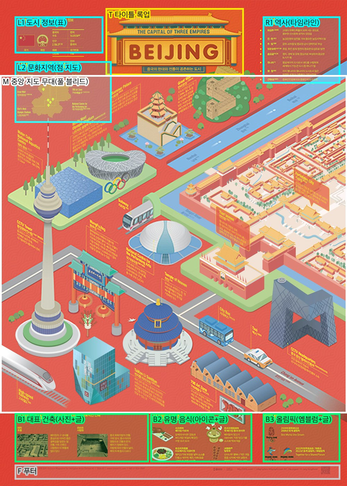
- **읽기 동선** [해석]
  1. 타이틀에서 시작한다.
  2. 왼쪽 위 기본 정보(L1→L2), 오른쪽 위 역사(R1)로 간다.
  3. 지도는 자유 탐색이다. 강·도로가 시선을 끌고, 라벨 카드가 정거장 역할을 한다.
  4. 하단 띠(B1→B3)에서 마무리한다.
- **고요한 영역(calm zone)** [실측] 상단 패널은 지도의 빈 빨간 땅 위에 그대로 얹혔다. 패널 아래에도 같은 바탕 무늬가 이어진다. 패널이 놓일 자리에 지도 요소를 두지 않았다.

### 3.2 네이티브 다이어그램 [실측, 상세는 부록 A]

- 전수 기록: `부록A-베이징-다이어그램.md` (도식 30개 표, 라벨 표, 규칙 R01~R26, 판독 원문)
- 도식 구성
  - 정보 패널 8개(D01~D08)
  - 지도 위 랜드마크·교통 라벨 17개(L01~L17)
  - 강·도로 이름 5개(G01~G05)
  - 방위표·축척 막대·범례·번호 배지·화살표는 **하나도 없다**.

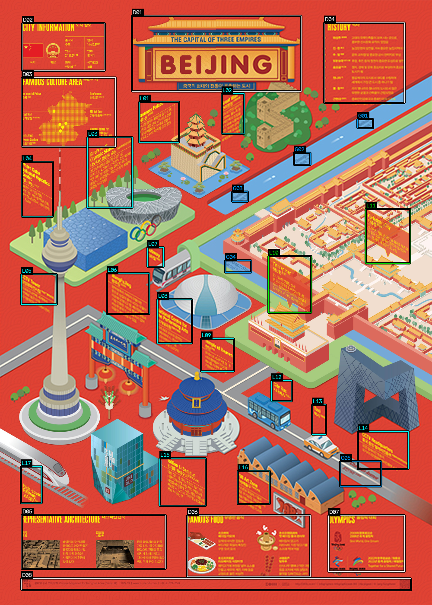

- **투영이 두 층으로 갈린다.**
  - 패널 8개는 전부 화면 평행(0°)이다.
  - 지도 위 라벨 22개는 전부 등각 평면에 붙는다. 지도 위에 화면 평행 글자는 하나도 없다.
  - 랜드마크·교통 라벨은 세워진 벽면에 붙는다. 기준선은 ±30°(실측 29.0~30.5°)이고 글자 세로획은 수직이다.
    - −30°가 14개다.
    - +30°는 3개다(이화원·만리장성·냐오차오). 모두 지도 북서쪽 띠에 있고 강과 평행하다.
  - 강·호수·도로 이름은 바닥면에 눕힌다. 지형 색의 진한 톤으로 쓰고 지시선은 없다.
- **라벨 스택은 하나로 고정이다. 모든 랜드마크가 같은 크기를 쓴다.**
  1. 영문 압축 볼드 대문자 3.8mm(1~3줄)
  2. 국문 볼드 3.8mm + 한자 위첨자 2.1mm
  3. 헤어라인 규선
  4. 본문 3.0mm(줄 피치 4.15mm, 0~7줄)
  - 노랑 단색이고 상자는 없다. 정보량 차이는 본문 줄 수로만 둔다.
- **지시선**
  - 수직 또는 ±30°만 쓰고 꺾임은 1회 이하다. 끝에 지름 0.9mm 점을 둔다.
  - 길이는 9.5~48mm(중앙값 약 20mm)다.
  - 수직선이 라벨 블록의 세로 테두리(브래킷) 역할을 겸한다.
- **라벨 형식 다섯 가지**

| 형식 | 개수 | 쓰는 곳 |
|---|---|---|
| 브래킷형 | 9 | 일반 랜드마크 |
| 규선 연장형 | 2 | 대상이 라벨 기울기 선상 바로 옆에 있을 때 |
| 반투명 말풍선 | 2 | 일러스트가 빽빽한 자금성 위에만 |
| 깃대형 이름표 | 4 | 교통수단처럼 설명이 필요 없는 작은 대상 |
| 지형명 | 5 | 강·호수·도로 |

  - 라벨은 대상의 위·좌상에 두는 것이 기본이다(지시선 ↓, 11개). 위가 막히면 아래에 두고 지시선 ↑로 잇는다(4개).
- **패널**
  - 제목은 영문 초압축 대문자(대문자 높이 7.4~7.8mm)다. 국문 소제목(3.6mm)을 영문 윗선에 맞춰 오른쪽에 붙인다.
  - 노랑 #FBF006 단색이다. 박스·배경판·구분선 없이 여백으로만 구획한다.
  - 좌측 정렬선 x≈21mm에 왼쪽 패널과 지도 왼쪽 라벨이 함께 맞는다.
- **타이틀 록업**은 주제 건축(궁궐 문)의 정면 입면 프레임이다. 등각 월드와 형식이 대비된다.
- **위치도**(FAMOUS CULTURE AREA)
  - 0.65mm 격자 점으로 그린 베이징시 실루엣에 물방울 핀 5개, 직교 지시선, 좌우 2열 라벨을 붙였다.
  - 중앙 지도가 실제 지리를 따르지 않는 점을 이 위치도가 실제 위치로 **보완**한다(R24). 3.4절의 지리 분석과 맞물리는 발견이다.
- **색**
  - 2색 체계다: 빨강 바탕 + 노랑 정보 잉크. 2차 정보는 진빨강 톤온톤으로 낮춘다.
  - 사진은 세피아·골드 듀오톤으로 채도를 죽여 팔레트에 편입한다.

### 3.3 투영·뷰포트·뷰 윈도우 [실측]

- **투영:** 지면 축은 −29.95° / +29.72°(타일 01), +30.10° / −30.04°(타일 04), −29.96° / +29.98°(타일 05)로 쟀다. 수직선은 ±89.6~89.9°다. 결론은 진짜 등각, 직교 투영이다.
- **카메라 방위**
  - 실제 북쪽이 화면 오른쪽 위 약 33°를 향한다.
  - 즉 화면 안쪽(위쪽)이 실제 서북서(방위 약 303°)다. 동남동 하늘에서 내려다보는 시점이다.
- **뷰 윈도우**
  - 포스터 액자는 지면을 45° 기울어진 직사각형으로 자른다.
  - 액자 밖으로 이어지는 요소 다섯 가지
    - 강: 오른쪽 위로 빠져나간다.
    - 자금성 블록: 오른쪽 가장자리에서 잘린다.
    - 창안대로: 아래로 빠져나간다.
    - 고속철: 왼쪽으로 빠져나간다.
    - 도로망: 왼쪽으로 빠져나간다.
  - 효과 [해석]: 지도가 더 큰 도시의 일부로 읽힌다. 특히 가장 큰 자금성을 잘라 크기를 강조한다.
- **요소별 투영** [실측·해석]
  - 정보 패널(L1, L2, R1, B1~B3)과 타이틀은 화면 평행이다. 평면도로 펴면 기울어 일그러지므로, 월드에 속하지 않는 오버레이임을 확인했다.
  - 지도 위 랜드마크 라벨은 랜드마크 옆의 등각 수직 평면에 붙는다. 글줄이 ±30°로 기운다.

### 3.4 뷰포트 밖 자유공간 추정

- **평면도 복원** [실측] `figures/bj_plan.jpg`

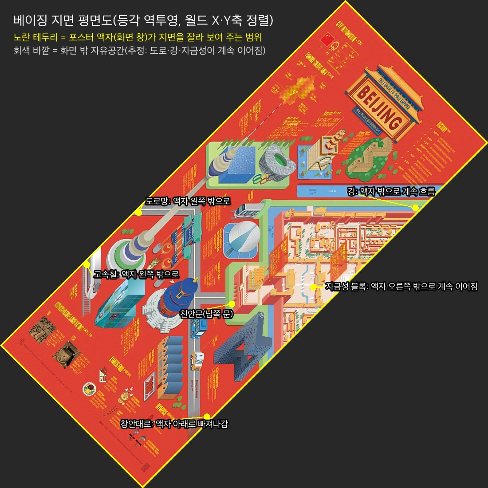

  - 지면 요소는 모두 월드 X·Y축에 맞춘 직교 배치다.
  - 강이 자금성 해자를 따라 직각으로 꺾인다. 도로는 T자·十자로 교차한다.
  - 공원은 직사각형 녹지 판이다.
- **화면 밖 연장** [추정]
  - 강은 오른쪽 위 액자 밖에서 들어온다.
  - 자금성은 실제 비례(961×753m)로 보아 액자 밖으로 절반 가까이 더 이어진다.
  - 창안대로·도로망·고속철은 액자 밖 도시로 계속된다.
- **지리 충실도** [실측] `.work/out/bj_geo.json`
  - 랜드마크 13곳의 바닥점을 평면 좌표로 바꿔 실제 위경도와 닮음변환으로 맞췄다.
  - 평균 오차는 131mm다. 지면 폭이 420mm이므로 실제 지리를 따르지 않는다는 뜻이다.
  - 다만 자금성–천안문–창안대로–천단–국가대극원의 국지 관계는 맞다. 천안문은 자금성의 남쪽 문이고 창안대로 옆에 있다.
- **거리 압축** [실측]
  - 평면 거리 ≈ 192mm × (실제 km)^0.10
  - 실제 0.8km인 천안문이 142mm, 58.6km인 만리장성이 239mm다.
  - 해석: 거의 모든 랜드마크를 중심에서 비슷한 거리에 고르게 흩어 놓았다.
- **크기 평준화** [추정, 목업 높이 ±10%]

| 대상 | 실제 높이 | 포스터 높이(아트 px) |
|---|---|---|
| 택시 | 1.5m | 약 110 |
| 시내버스 | 3.2m | 약 180 |
| 798 공장 | 약 12m | 약 200 |
| 천안문 | 34.7m | 약 310 |
| 국가대극원 | 46m | 약 190 |
| 냐오차오 | 69m | 약 180 |
| 이화원 불향각(언덕 포함) | 약 100m | 약 310 |
| CCTV 본사 | 234m | 약 400 |
| CCTV 타워 | 405m | 약 1310 (예외, 구도 척추) |

  - 실제 높이 차는 150배를 넘는데, 포스터 높이는 약 110~400px로 4배 안에 묶인다.

### 3.5 오브젝트 크기 정밀 분석 [실측]

- 방법
  - 지도 오브젝트 16개를 GrabCut으로 윤곽 분할했다. 받침(녹지·연못·언덕 판)은 포함했다.
  - 바탕 빨강과 색차 ΔE > 14인 화소만 남겼다.
  - 스크립트: `.work/scripts/bj_objects.py`, 결과: `.work/out/bj_objects.json`

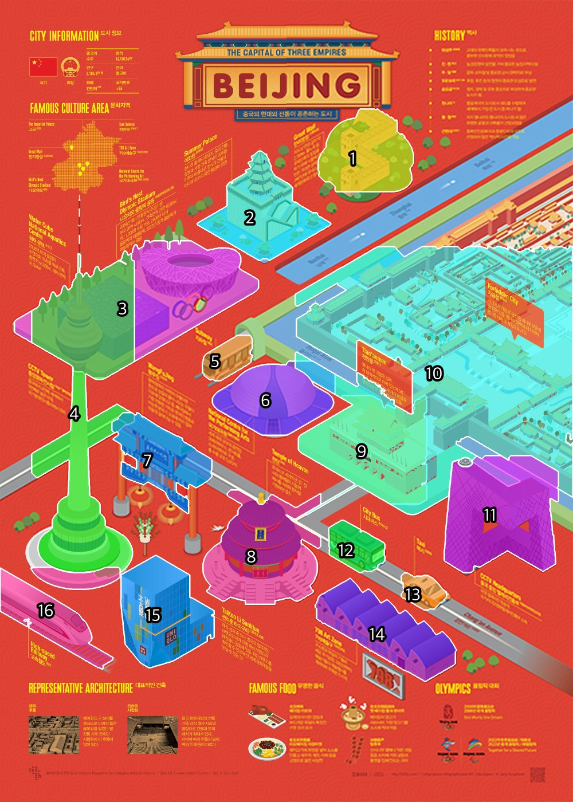

| # | 오브젝트 | 화면 폭×높이(mm) | 면적(mm²) | 지도 무대 대비 |
|---|---|---|---|---|
| 1 | 만리장성(언덕 받침) | 69.9×61.3 | 3,354 | 1.93% |
| 2 | 이화원(연못 받침) | 97.9×81.0 | 3,768 | 2.17% |
| 3 | 냐오차오·워터큐브(녹지 받침, 묶음) | 178.9×101.6 | 10,156 | 5.85% |
| 4 | CCTV 타워(세로 척추) | 약 75×277※ | — | — |
| 5 | 지하철 | 36.5×33.7 | 849 | 0.49% |
| 6 | 국가대극원 | 89.9×54.9 | 3,568 | 2.06% |
| 7 | 왕푸징 패루 | 73.3×74.7 | 2,725 | 1.57% |
| 8 | 천단 | 86.3×84.6 | 4,942 | 2.85% |
| 9 | 천안문(녹지 받침) | 94.1×80.4 | 5,230 | 3.02% |
| 10 | 자금성 블록(중심, 액자에 잘림) | 203.5×198.7 | 29,023 | 16.73% |
| 11 | CCTV 본사 | 83.8×86.7 | 5,947 | 3.43% |
| 12 | 시내버스 | 41.2×38.8 | 1,115 | 0.64% |
| 13 | 택시 | 33.2×27.4 | 644 | 0.37% |
| 14 | 798 예술구 | 103.3×76.1 | 3,743 | 2.16% |
| 15 | 싼리툰 타이구리 | 68.5×83.1 | 3,527 | 2.03% |
| 16 | 고속철 | 88.0×75.3 | 2,935 | 1.69% |

※ CCTV 타워: 분할 결과에 옆 도로 일부가 섞여 면적은 빼고, 폭(받침 원반)과 높이(안테나 끝~받침 바닥, 격자 판독 ±5mm)만 적었다.

- **크기 등급**

| 등급 | 크기 | 비고 |
|---|---|---|
| 중심 블록 | 약 204×199mm | 포스터 폭의 48%, 지도의 16.7%. 하나뿐이다 |
| 표준 랜드마크(9개) | 폭 68.5~103.3mm, 높이 54.9~86.7mm. **중앙값 86×80mm** | 포스터 폭의 약 20%(16~25%). 하나당 지도 면적의 약 2.2% |
| 묶음 받침 | 약 179×102mm | 냐오차오·워터큐브 1개만 |
| 세로 척추 | 약 75×277mm | 1개 |
| 탈것 | 33~41mm | 고속철만 88mm로 길다 |

- **밀도**
  - 오브젝트 합집합이 지도 무대(420×413mm)의 **46.2%**, 포스터의 32.2%를 덮는다.
  - 오브젝트 박스는 가장 가까운 이웃과 사실상 맞닿거나 겹친다(간격 중앙값 0mm).
  - 빈자리는 도로·강·라벨이 채운다. 즉 지도는 '오브젝트 사이에 길과 글이 끼어 있는' 고밀도 판이다.
- **우리 포스터에 주는 기준** [해석]
  - 주요 랜드마크는 최소 86×80mm급(포스터 폭의 약 20%)으로 만든다.
  - 히어로는 약 200mm급으로 만든다.
  - 작은 소품·탈것은 33~45mm로 만든다.
  - 오브젝트가 지도의 45% 안팎을 덮도록 배치한다.

---

## 4. 신문 제작 과정

### 4.1 지면 레이아웃 [실측]

| 코드 | 영역 | x (mm) | y (mm) | 크기 | 지면 비율 |
|---|---|---|---|---|---|
| T | 타이틀 띠: WHAT IS A NEWSPAPER?(정의+특성 칩 7개) / "The Ultimate Infographic Guide to Newspaper · The Journey of Newspaper · 한국 신문과 활판인쇄 기술의 역사" / ADVANTAGES OF NEWSPAPERS(아이콘 4개) | 10~410 | 22~100 | 400×78 | 12.5% |
| L | HISTORY OF KOREAN NEWSPAPERS 한국 신문 역사(세로 리본 타임라인) | 18~78(지그재그가 들어간 곳은 ~105) | 105~575 | — | 약 20% |
| M | LETTERPRESS PRINTING PROCESS 활판인쇄 과정(계단형 바닥) | 78~305 | 100~562 | 227×462 | 42.0% |
| R1 | NEWSPAPER REFORMER: PULITZER | 305~412 | 105~155 | 107×50 | 2.1% |
| R2 | CHANGES IN NEWSPAPER PRINTING | 305~412 | 158~252 | 107×94 | 4.0% |
| R3 | LAYOUT OF A NEWSPAPER(주석 지면) | 305~412 | 262~385 | 107×123 | 5.3% |
| R4 | NEWSPRINT(두께·롤·무게 비교) | 305~412 | 388~482 | 107×94 | 4.0% |
| R5 | TOP 6 INFLUENTIALS(막대그래프, 무대가 끝난 자리로 왼쪽 확장) | 265~412 | 485~565 | — | 3.4% |
| F | 푸터 | 18~412 | 565~579 | 394×14 | 2.2% |

- 영역 지도: `figures/np_zones.jpg`

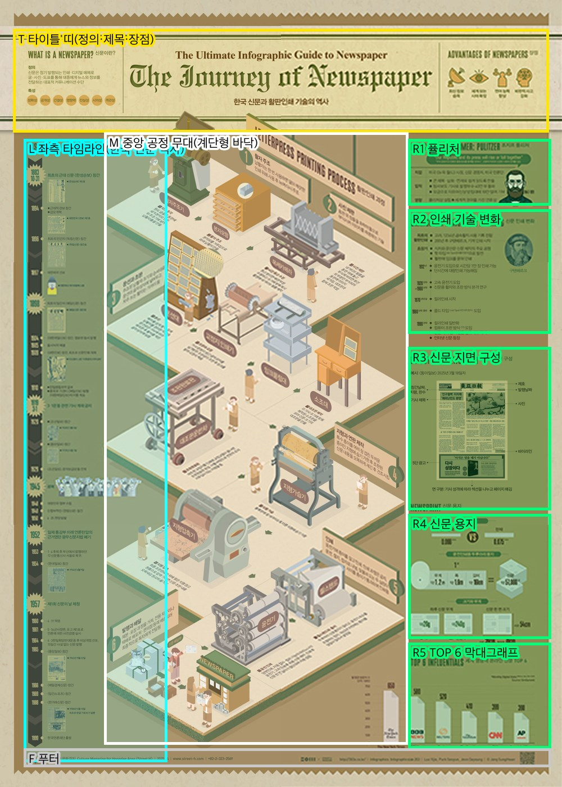

- 테두리: 위아래에 핑킹 가위 모양의 지그재그 종이 테두리(약 14~20mm)가 있다.
- **읽기 동선** [해석]
  1. 타이틀 띠를 왼쪽 정의 → 가운데 제목 → 오른쪽 장점 순으로 읽는다.
  2. 이어서 세 줄기가 평행하게 위에서 아래로 내려간다: 좌측 역사, 중앙 공정 1→6, 우측 칼럼.
  3. 중앙 공정이 주 동선이다. 칼럼은 무대와 맞물려 보조 동선이 된다.

### 4.2 네이티브 다이어그램·공정도 [실측, 상세는 부록 B]

- 전수 기록: `부록B-신문-다이어그램.md`
- **도식 9개와 부속 삽화 5개**
  - D1 상단 띠 3분할(정의 | 타이틀 | 장점)
  - D2 세로 연표(29항목)
  - D3 등각 공정도
  - D4 퓰리처 카드
  - D5 인쇄 변화 목록
  - D6 주석 지면
  - D7 신문 용지 수치
  - D8 TOP 6 막대그래프
  - D9 푸터
  - 입체(등각)는 D3에만 쓴다. 나머지는 모두 화면 평행이다(G13).
- **공정도 바닥**
  - 정사각 셀 9개(평면 한 변 약 86mm, 화면 148×87mm 마름모)를 L0 → R0 → L1 → R1 → … → L4 순서로 이었다.
  - 한 행은 셀 2개(+X, ↘)다. 다음 행으로는 +Y(↙)로 내려간다.
  - 화면에서는 두 열을 반 셀(약 43mm)씩 번갈아 내려가는 지그재그다.
  - 4.4절의 '2:1 판 4장 + 정사각 판 1장'과 같은 구조다. 2:1 판 하나가 셀 2개다.
- **단계 배분**
  - 6단계를 셀 9개에 1·1·3·2·1·1로 나눴다. 핵심이고 볼거리가 많은 단계에 셀을 더 준다(P6).
- **간판**
  - 각 단계가 시작되는 셀의 뒤 가장자리에 세운 수직 보드다. 오른쪽 벽은 글줄 ↘30°, 왼쪽 벽은 ↗30°이고, 세로획은 수직이다.
  - 단계명 3.8mm에 본문 2~3줄(약 50자)이 붙는다.
  - 번호 배지(녹색 타원 10.5×13mm)는 포스터 바깥쪽 끝에 단다.
  - 공정도 제목도 첫 셀 뒤에 세운 가장 큰 보드(110×71mm, 글자 9.8mm)다. 세계 안의 '입구 간판'이다(P14).
- **바닥 글**
  - 세부 설명 ①~⑫는 바닥에 눕혀 쓴다(2.1~2.3mm). 번호는 단계와 따로 공정 전체 연번이고, 짙은 사각 번호 배지를 단다.
  - 대분류(간판 6)와 소분류(바닥 12)의 2층 구조다.
- **동선**
  - 선이나 띠는 쓰지 않는다. 바닥에 눕힌 작은 화살표(5×3mm, 올리브) 13개만 쓴다.
  - 방향은 +X(↘)와 +Y(↙) 두 가지뿐이고, 셀 경계 8곳 중 7곳에 놓인다.
- **인물**
  - 사람 11명과 마스코트 고양이(MOMO)가 있다.
  - 키는 26~29mm로, 셀 모서리의 0.3배, 기계 높이의 0.35~0.6배다.
  - 동작은 가리키기, 결과물 들어 보이기, 도구 들기, 읽기 네 가지다.
  - 마지막 셀은 기계 없이 가판대·배달부·독자가 있는 생활 장면으로 끝난다(P11).
- **미세 구조**: 맨눈으로 안 보이는 재료 구조(납활자)는 기계 위에 겹친 원형 확대 창(지름 약 23mm)으로 보여 준다(P12).
- **평면 블록**
  - 영문 대문자 압축체 제목(5.5~5.7mm)에 국문 부제를 붙이고, 본문(2.6~3.0mm)은 상자 없이 배경 위에 바로 놓는다.
  - 속성은 원형 칩(지름 8mm) 7개, 장점은 아이콘(9.5mm) 4개로 보여 준다.
  - 연표 띠는 9mm 폭이고, 주요 사건 약 20%만 별 배지로 올린다. 항목 간격은 시간이 아니라 내용에 비례한다.
  - 막대그래프는 막대가 주제 사물 모양(접힌 신문지)이고 격자선이 없다.

### 4.3 투영·뷰포트·뷰 윈도우 [실측]

- **투영:** 지면 축은 −30.04° / +30.03°(타일 01), −30.00° / +29.99°(타일 04), +30.16° / −30.24°(타일 05)로 쟀다. 결론은 진짜 등각이다.
- **뷰 윈도우**
  - 무대 전체가 액자 안에 있고 사방이 허공(카키 바탕)이다.
  - 맨 위의 활자주조기와 'LETTERPRESS PRINTING PROCESS' 간판만 타이틀 띠 아래 선을 넘어 위로 겹친다.
  - 효과 [해석]: 무대가 지면 앞으로 튀어나와 보인다.
- **요소별 투영** [해석]
  - 타이틀 띠·칼럼은 화면 평행이다.
  - 단계 간판은 판 끝에 선 수직 패널이다(등각 수직 평면).
  - 기계별 세부 설명은 판 윗면에 눕혀 썼다(등각 수평면).

### 4.4 뷰포트 밖 자유공간 추정: 계단형 바닥 복원 [실측]

- 그림: `figures/np_floor.png`

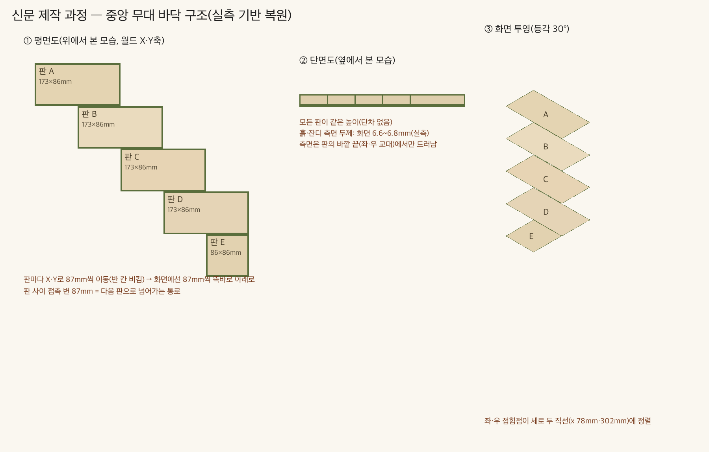

- **판 분할**
  - 판 윗면(Lab L 85~87, b +16~19)을 분할했고, 흙 측면 띠도 따로 검출했다.
  - 측면 띠는 판 끝에서만 나타난다. 왼쪽 끝은 −30° 방향, 오른쪽 끝은 +30° 방향이고, 세로 두께는 6.6~6.8mm로 일정하다.
  - 판 사이에 단차가 없다. 윗면이 이어져 있고, 측면이 판 끝에서만 보이기 때문이다.
- **꼭짓점 역투영(같은 높이 가정이 성립)**

| 판 | 평면 X 범위 | 평면 Y 범위 | 크기 |
|---|---|---|---|
| A | 203~376 | 27~113 | 173×86 |
| B | 290~462 | 114~200 | 172×86 |
| C | 377~549 | 200~287 | 172×87 |
| D | 463~636 | 287~373 | 173×86 |
| E | 551~637 | 373~461 | 86×88 |

  - 판마다 X·Y로 87mm씩 이동한다(긴 변의 절반, 짧은 변 하나만큼).
  - 화면 좌측 접힘점은 y 160·248·335·422·509mm, 우측 접힘점은 y 204·291·378·466mm에 있다. 피치는 87mm다.
- **세계의 범위** [해석]
  - 허공에 뜬 단일 바닥이다. 액자 밖으로 이어지는 공간이 없는 닫힌 디오라마다.
  - 판의 진행 방향(+X+Y)은 관찰자 쪽이다. 공정이 진행될수록 판이 관찰자에게 다가온다.
  - 이 바닥은 '보행로'처럼 읽힌다. 판 사이 접촉 변(87mm)이 다음 공정으로 넘어가는 통로다.

---

## 5. 두 포스터에서 뽑은 규칙

> 5절은 하위 분석(`diagrams_bj.md`, `diagrams_np.md`)의 도식 규칙을 받은 뒤 보완한다. 아래는 레이아웃·투영·공간 측정에서 나온 규칙이다.

### 5.1 틀
- A2 세로, 좌우 여백 18mm, 푸터 14~18mm, 타이틀은 상단 중앙.
- 정보 패널은 모두 화면 평행. 월드(무대) 요소만 등각.

### 5.2 투영
- 진짜 등각(지면 축 ±30°, 카메라 고도 35.264°)을 포스터 전체에 하나로 쓴다.
- 광원은 왼쪽 위 하나다. 윗면이 가장 밝고, 왼쪽 면이 중간, 오른쪽 면이 가장 어둡다.

### 5.3 공간 배치(베이징 방식)
- 지도 무대는 지면의 약 70%이고 풀 블리드다. 지면은 직교 격자로 짓는다.
- 중심 블록 하나를 가장 크게 둔다. 지면 폭의 약 45%이고, 중앙에서 오른쪽이다.
- 나머지 랜드마크는 중심에서 140~340mm 거리에 고르게 흩는다.
- 실제 지리는 중심축 관계만 지킨다. 나머지는 구도를 우선한다.
- 랜드마크 크기는 2~4배 폭 안으로 평준화한다. 세로로 긴 강조물 하나는 구도의 척추로 허용한다.
- 강·도로·철도는 랜드마크를 잇고 액자 밖으로 빠져나간다. 세계가 계속됨을 보여 준다.
- 정보 패널은 지도의 빈 모서리(고요한 영역)에 둔다. 좌상 2단, 우상 1단, 하단 3분할 띠다.

### 5.4 동선(신문 방식)
- 공정은 같은 높이의 2:1 판을 반 칸씩 비켜 이은 지그재그 바닥 위에 순서대로 놓는다. 화면에서는 위에서 아래로 내려온다.
- 판 하나에 공정 1~2단계를 놓는다. 단계 간판은 판의 바깥 끝에 좌우 교대로 세운다.
- 바닥에는 작은 화살표로 진행 방향을 표시한다.
- 정보 칼럼은 무대의 지그재그와 맞물린다. 무대가 들어간 자리를 칼럼 내용이 채운다.

### 5.5 색
- 바탕 한 색이 지면의 40~50%를 덮는다. 제목 강조색은 하나다.
- 대상 고유색은 바탕 위에 얹는다.
- 베이징은 2색 체계다: 바탕 + 정보 잉크 한 색. 2차 정보는 바탕 톤온톤으로 낮춘다.

### 5.6 도식 문법(베이징 R01~R26 요약, 부록 A 7장)
- **두 투영 층**
  - 패널은 화면 평행이다.
  - 지도 위 글자는 전부 등각 평면에 붙인다. 이름·설명은 벽면에 세우고, 지형명은 바닥에 눕힌다.
  - 지도 위에는 화면 평행 글자를 두지 않는다.
- **벽면 방향**은 −30°가 기본이다. 한 구역 안에서는 한 방향으로 통일하고, 그 구역의 선형 요소(강·대로·성벽)와 평행하게 한다.
- **라벨 스택**(모든 랜드마크 같은 크기)
  1. 영문 압축 볼드 3.8mm
  2. 국문 볼드 3.8mm + 원어 위첨자 2.1mm
  3. 규선
  4. 본문 3.0mm / 4.15mm
  - 정보량은 줄 수로만 조절한다.
- **지시선**
  - 수직·±30°만 쓴다. 꺾임은 1회 이하이고 끝에 0.9mm 점을 둔다. 화살표는 쓰지 않는다.
  - 라벨은 대상 위·좌상이 기본이다. 위가 막히면 아래에 둔다.
- **형식 선택**
  - 일반 랜드마크: 브래킷형
  - 빽빽한 일러스트 위: 반투명 말풍선
  - 작은 탈것·소품: 깃대형 이름표
  - 지형: 지형색 톤온톤
- **패널**
  - 제목은 영문 초압축 대문자 7.4~7.8mm에 국문 3.6mm를 윗선 정렬로 붙인다.
  - 박스·배경판 없이 여백으로 구획한다. 정렬선을 공유한다(좌측 x≈21mm).
- **타이틀**은 주제 건축의 정면 입면 프레임이다(월드의 등각과 대비).
- **위치도**: 월드가 지리적으로 부정확하면, 점 실루엣 + 핀 위치도로 실제 위치를 보완한다.
- **사진**은 듀오톤으로 팔레트에 편입한다. 숫자는 크게, 단위는 위첨자로 쓴다.

### 5.7 공정·블록 문법(신문 G1~G14, P1~P14 요약, 부록 B 4장)
- **공정 바닥**
  - 정사각 셀 체인이다. 한 행 2셀(+X), 다음 행 +Y로 내려간다.
  - 같은 높이의 얇은 판이고, 측면은 바깥 앞쪽 변에만 둔다.
  - 셀 배분은 복잡도에 비례시킨다.
- **간판**
  - 단계가 시작되는 셀의 뒤 가장자리에 세운 수직 보드다(글줄 ±30°, 세로획 수직).
  - 단계명 3.8mm + 본문 2~3줄이다. 번호 배지는 포스터 바깥쪽 끝에 단다.
  - 공정 제목은 첫 셀 뒤의 가장 큰 보드다.
- **바닥 글**: 세부 설명은 바닥에 눕힌 2.1~2.3mm 글이고, 공정 전체 연번을 매긴다. 간판(대분류)과 함께 2층 구조를 이룬다.
- **동선**: 선 없이 작은 바닥 화살표만 쓴다. 방향은 +X·+Y 두 가지이고, 셀 경계마다 하나씩 둔다.
- **인물**
  - 셀 모서리의 0.3배, 기계의 0.35~0.6배 크기다.
  - 거의 모든 셀에 1~2명을 둔다. 동작은 가리키기·들어 보이기·도구 들기다.
  - 마지막 셀은 사용 장면으로 끝낸다.
- **미세 구조**: 원형 확대 창으로 보여 준다.
- **평면 블록**
  - 영문 압축 제목 + 국문 부제를 쓰고, 상자 없이 배경 위에 조판한다.
  - 대등한 속성은 원형 칩으로, 장점은 아이콘 열로 보여 준다.
  - 연표는 내용 비례 간격에, 주요 사건만 배지로 올린다.
  - 막대는 주제 사물 모양으로 그리고 격자선은 쓰지 않는다.
- **빈자리**: 등각 무대의 톱니 바깥 빈자리를 옆 블록의 삽화·차트로 채운다.
- **입체**: 등각 입체는 이야기의 몸통(무대)에만 쓴다.

---

## 6. 로마 콘크리트 포스터 적용안

### 6.0i 현재안 v16 (2026-10-18 18:20): AAA 적대적 리뷰 루프와 병렬 생성 구조

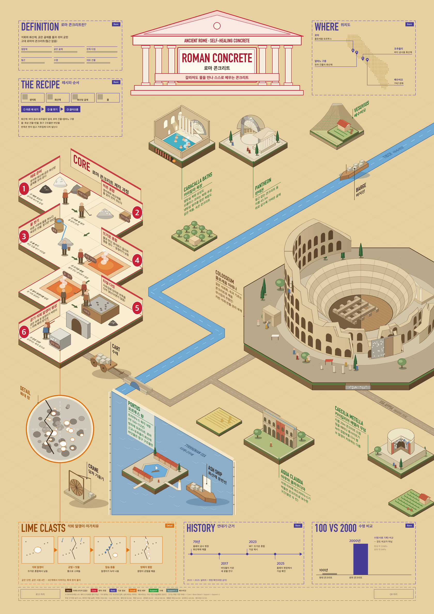

- **사용자 지시**
  - 16:08: 생성자–평가자(GAN) 구조로, 혹독한 비평가들이 정밀 판정·적대적 리뷰를 한다. 모두 AAA가 될 때까지 수정과 재리뷰를 반복한다.
  - 18:03: 생성자가 너무 오래 걸린다. Opus 5.5로 진행하고, 워커 에이전트를 여러 개 만들어 병렬로 작업한다.

**1회차(v15 판정)**

| 비평가 | 등급 | 점수 | 지적 | 핵심 |
|---|---|---|---|---|
| 벤치마크 충실도 | C | 48 | 17 | 지도 위 글자 전부 0°, 지시선 문법 없음, 강 수직 구간, 오브젝트 점유율 29.6%(베이징 46.2%) |
| 정보 위계·사용자 요구 | C | 52 | 24 | 손으로 넣은 REG가 도면과 달라 욕장이 Basic 최소보다 큼(위계 역전), 추가 Support 미확정 |
| 시각 구성·가독성 | C | 46 | 19 | 라벨–오브젝트 충돌 8곳 이상, 아레나 받침이 강 위에 얹힘, 좌우 여백 불균형 |
| 사실 정확성·제작 가능성 | C | 45 | 21 | 베수비오(연기·두 봉우리), 카라칼라 '복원 추정' 미표기, '타설' 표기, Core 인물 0명 |

- **v16**: 1회차 지적 81건을 생성자 1명이 반영했다(약 1시간 30분).
  - 지도 위 글자를 등각 평면에 놓고, 규격 지시선을 넣었다.
  - 강을 ±30° 축으로 다시 그렸다.
  - 레이어 알파 외곽 상자로 투영 크기를 자동 실측하는 검사표를 만들었다.
  - 베수비오 밑동을 포도밭 농장으로 가렸다.
  - 추가 Support에 카이킬리아 메텔라 무덤을 넣었다.
  - Core 셀에 간판·인물·기계·바닥 글을 넣었다.
- **원인 확인**: ECC의 `gan-generator`·`gan-evaluator` 정의가 `model: sonnet`이었다. 지침도 웹앱용이었다(개발 서버·Playwright·git 커밋). 그래서 2회차부터는 범용 에이전트에 역할 지시를 주고, 모든 에이전트를 Opus 5.5(`claude-opus-5-5`)로 고정했다.

**병렬 생성 구조(2회차부터)**

- v16 단일 파일(2,570줄)을 담당 패키지별 모듈로 나눴다: `.work/scripts/wf/v16/`.
  - 그리는 코드는 한 줄도 바꾸지 않았다. 분할본의 출력 PNG MD5가 원본과 같다(`18593a37…`).
  - 담당 표는 `.work/scripts/wf/OWNERS.json`.

| 패키지 | 파일 | 범위 |
|---|---|---|
| core | m_core.py | Core 제작 과정 셀 체인 |
| arena | m_arena.py | 아레나 |
| support_top | m_support_top.py | 욕장·판테온·베수비오·포도밭 농장 |
| support_bottom | m_support_bottom.py | 수도교·포르투스·메텔라 무덤 |
| map | m_map.py | 지면·강·바다·길·풍경 소품·지형명 |
| panels | m_panels.py | 타이틀·Basic·Detail 패널·확대 창·푸터 |
| global | common.py·analysis.py·main.py | 공용 도구·자동 검사·조립 |

- **한 회차의 흐름**
  1. 비평가 4명이 병렬로 판정한다. 지적마다 담당 패키지를 붙인다.
  2. 기획자 1명이 지적을 합치고 반려 사유를 적는다. 패키지를 넘는 배치를 mm 수치로 정하고, 패키지별 영역·작업·완료 기준을 낸다.
  3. 워커들이 병렬로 고친다. 패키지마다 1명이고, 각자 사본 `.work/scripts/wf/work/v{N+1}.{패키지}/`에서 담당 파일만 고친다.
  4. 통합 담당 1명이 이어서 처리한다.
     - `merge.py`로 담당 파일만 병합하고, 담당 밖 변경은 버린 뒤 알린다.
     - 렌더하고 자동 검사를 돌린다.
     - 패키지 사이의 충돌을 정리한다.
     - crop을 만들고 화면에 연다.
- **판정 자료**: 비평가가 직접 측정하던 것을 미리 만들어 준다.
  - `wireframe_v{N}_measure.json`: 상자·면적·라벨 상자·검사 출력.
  - `_hi.png`: 1mm = 8px 고해상도본.
  - `review/v{N}/`: 오브젝트·패널·구역 crop 32개.

**v16 투영 크기 자동 실측**(레이어 알파 외곽 상자, 폭×높이 mm)

| 티어 | 요소 | 투영 크기 | 상자 면적(mm²) |
|---|---|---|---|
| 아레나 | 아레나 | 184.2×166.2 | 30,632 |
| Core | 제작 과정 | 120.4×213.5 | 25,700 |
| Detail | 석회 알갱이 패널 | 152.4×60.1 | 9,162 |
| Basic | 위치도 / 연대기 / 100 vs 2000 / 레시피 / 정의 | 100~116 × 48~72 | 4,831~7,240 |
| Detail | 확대 창 | 66.1×66.1 | 4,373 |
| Support | 욕장 / 수도교 / 판테온 / 메텔라 무덤 / 포르투스 | 64~68 × 46~62 | 2,961~3,959 |
| Support-2 | 베수비오 | 52.4×45.4 | 2,377 |

- **위계 검사**: 아레나 30,632 > Core 25,700 > Basic·Detail 최소 4,373 > Support 최대 3,959 > Support-2 2,377로 통과했다. 마진 10% 조건도 통과했다.
- **2회차 중 들어온 사용자 지시**: 비평보다 우선한다. 기획자·워커·통합 담당에게 넘겼다.

| 시각 | 지시 | 반영 방법 |
|---|---|---|
| 18:25 | 포르투스는 바다에 뜬 섬이 아니다. 트라야누스 육각 내항은 육지, 클라우디우스 외항은 바다에 있다. 등대가 보여야 한다. | 해안선을 사이에 두고 내항(육지, 창고 열)과 외항(바다, 방파제 두 팔)을 수로로 잇는다. 외항 입구 섬에 층을 쌓은 등대를 세운다. |
| 18:25 | 바다가 호수처럼 보인다. 왼쪽 아래 모서리 구간 전부를 바다로 잡는다. | ±30° 대각 해안선으로 바다를 왼쪽 변과 지도 아래 변 밖까지 잇는다. 좌우 부두 벽은 없앤다. 테베레강 하구는 이 바다로 흘러든다. |
| 18:29 | 포르투스 참조는 복원 판화(`docs/references/assets/포르투스-참조-판화.png`)다. | 판화의 육각 내항·원형 외항·창고 열주·4층 등대·범선을 따르되, 바다가 왼쪽 아래를 향하게 뒤집는다. 판화 속 거상은 상상도라 라벨에서 사실로 쓰지 않는다. |
| 18:32 | 모든 오브젝트를 고도화한다. 레이어를 더 많이 쓰고, 폴리곤과 삼각 원시 면을 더 넣는다. | 공용 로우폴리 라이브러리 `prim.py`를 v16에 추가했다. 패키지마다 최소 기준(지층 받침, 다면 돔, 높이장 화산, 삼각 격자 물 면 등)을 준다. |

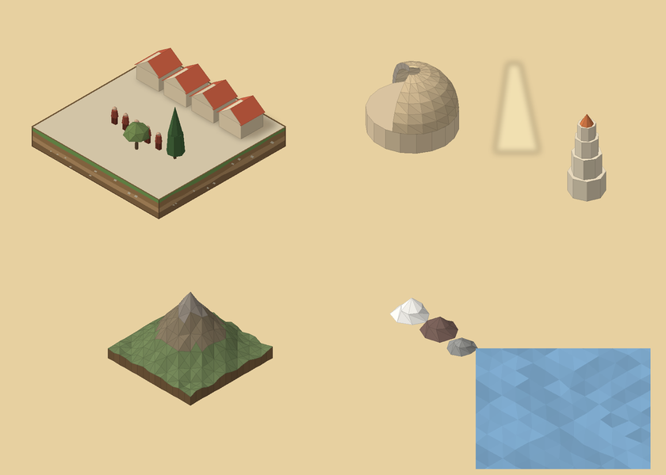

- **prim.py 시험 렌더**(0.24초)
  - 대상: 지층 받침·박공 창고 열·로우폴리 나무와 사람, 절개 다면 돔, 층을 쌓은 등대, 높이장 화산, 재료 더미, 삼각 격자 바다.
  - 기존 그리기 코드는 바꾸지 않았다. v16 출력 MD5는 그대로다.
- **2회차(v16 판정)**: 진행 중. 결과는 이 절에 이어서 적는다.

### 6.0h 이전안 v15 (2026-10-18 16:30): 베이징 구조에 가중치

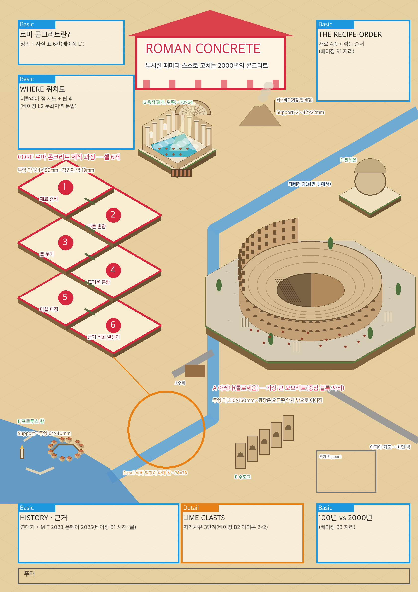

- **사용자 지정**: v13은 별로다. 베이징 인포그래픽에 가중치를 더 두고 구조를 잡는다.
- **베이징 실측 구획(3.1절) 그대로 + 우리 위계**

| 베이징 | 우리 |
|---|---|
| T 건축 액자 타이틀(128~295 × 10~92) | 로마 신전 페디먼트 정면 입면 |
| L1 도시 정보 | Basic 로마 콘크리트란? |
| L2 문화지역 점 지도 | Basic WHERE 위치도(이탈리아 점 지도 + 핀) |
| R1 역사 | Basic 레시피·순서 |
| 대각 강 띠(오른쪽 위에서 들어와 직각으로 꺾임) | 테베레강 |
| 중앙~오른쪽 중심 블록(자금성) | 아레나(가장 큼, 광장은 오른쪽 액자 밖으로 이어짐) |
| 왼쪽 세로 척추 자리(CCTV 타워·워터큐브) | Core 제작 과정 셀 6개 |
| 위쪽 줄(이화원) | 욕장(뒤쪽) |
| 가장 먼 대상(만리장성) | 베수비오 Support-2 |
| 아래쪽 줄(천단·798·탈것) | 포르투스·수도교·추가 후보·수레 |
| B1 대표 건축 / B2 음식 / B3 올림픽 | 연대기·근거 / Detail 석회 알갱이 / 100 vs 2000 |

- **투영 크기 위계 검사**(스크립트 출력)
  - 아레나 210×154 > Core 144×199 > Basic·Detail 최소 107×45
  - Basic·Detail 최소 > Support 최대(욕장 70×64) > Support-2(베수비오 42×32)
  - 통과

### 6.0g 이전안 v13 (2026-10-18 16:20): 정보 위계 배치, 크기는 모두 투영 기준

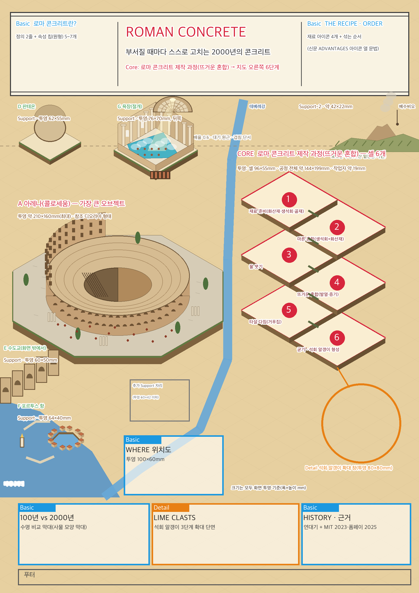

- **사용자 지정**
  1. 정보 위계를 생각해서 배치한다.
  2. 아레나가 제일 커야 한다.
  3. Core 정보는 '콘크리트 제작 과정'이므로 크기를 키운다.
  4. Support는 Core·Basic·Detail보다 작아야 한다.
  5. 크기는 전부 투영(projection) 기준이다.
- **위계 재정의**
  - Core: 로마 콘크리트 제작 과정 6단계(신문식 셀 체인)
    1. 재료 준비(화산재·생석회·골재)
    2. 마른 혼합(생석회+화산재)
    3. 물 붓기
    4. 뜨거운 혼합(발열·증기)
    5. 타설·다짐(거푸집)
    6. 굳기·석회 알갱이 형성
  - Basic: 정의, 레시피·순서, 위치도, 100년 vs 2000년, 연대기·근거
  - Detail: 석회 알갱이·자가치유(하단 패널 + 6단계에서 이어지는 확대 창)
  - Support: 판테온·욕장·수도교·포르투스·추가 후보
  - Support-2: 베수비오
- **투영 크기 검사표** [실측: 와이어프레임 도면 좌표, 스크립트가 출력]

| 위계 | 요소 | 투영 폭×높이(mm) | 면적(mm²) |
|---|---|---|---|
| 아레나 | 콜로세움 | 210×160 | 33,600 |
| Core | 제작 과정 셀 6개 | 144×199 | 28,656 |
| Basic | 정의 / 레시피·순서 | 108×76 / 108×76 | 8,208 / 8,208 |
| Basic | 위치도 / 100 vs 2000 / 연대기·근거 | 100×60 / 132×62 / 110×62 | 6,000 / 8,184 / 6,820 |
| Detail | 석회 알갱이 패널 / 확대 창 | 148×62 / 80×80 | 9,176 / 6,400 |
| Support | 욕장 / 판테온 / 수도교 / 포르투스 / 추가 후보 | 76×70 / 62×55 / 60×52 / 64×41 / 60×42 | 5,320 / 3,410 / 3,120 / 2,624 / 2,520 |
| Support-2 | 베수비오 | 42×26 | 1,092 |

- **검사 결과**: 아레나 33,600 > Core 28,656 > Basic·Detail 최소 6,000 > Support 최대 5,320 > Support-2 1,092. 통과.

### 6.0f 이전안 v11 (2026-10-18 16:15): 지도 구조 철회, v7 구조로 복귀 + 작은 재현도형 포르투스

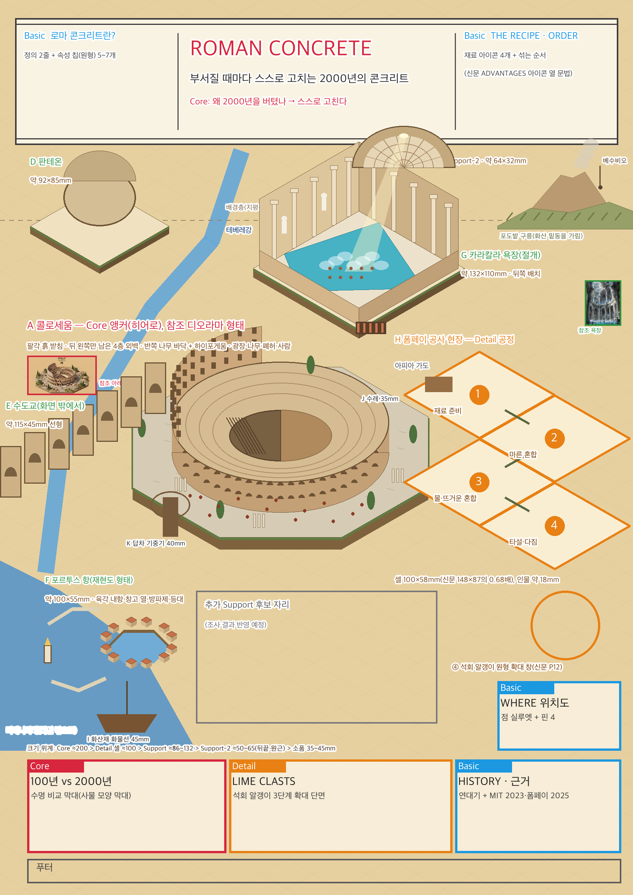

- **사용자 지정**
  - 포르투스 평면도 뼈대 지시를 철회했다("지도 구조 철회"). 6.0e(v9~v10)는 폐기한다.
  - 항 크기를 더 줄인다.
- **적용**
  - 중앙 지도는 v7 구조로 되돌렸다.
  - 포르투스만 재현도 형태로 바꾸고 약 100×55mm로 줄여 왼쪽 아래 바다에 두었다. 육각 내항 + 붉은 기와 창고 열 + 짧은 곡선 방파제 두 팔 + 등대로 구성한다.
  - 나머지(콜로세움·욕장·베수비오·공정 셀·판테온·수도교)는 v7과 같다.

### 6.0e 폐기안 v9 (2026-10-18 16:10, 사용자 철회): 중앙 지도 구조 = 포르투스 평면도 뼈대

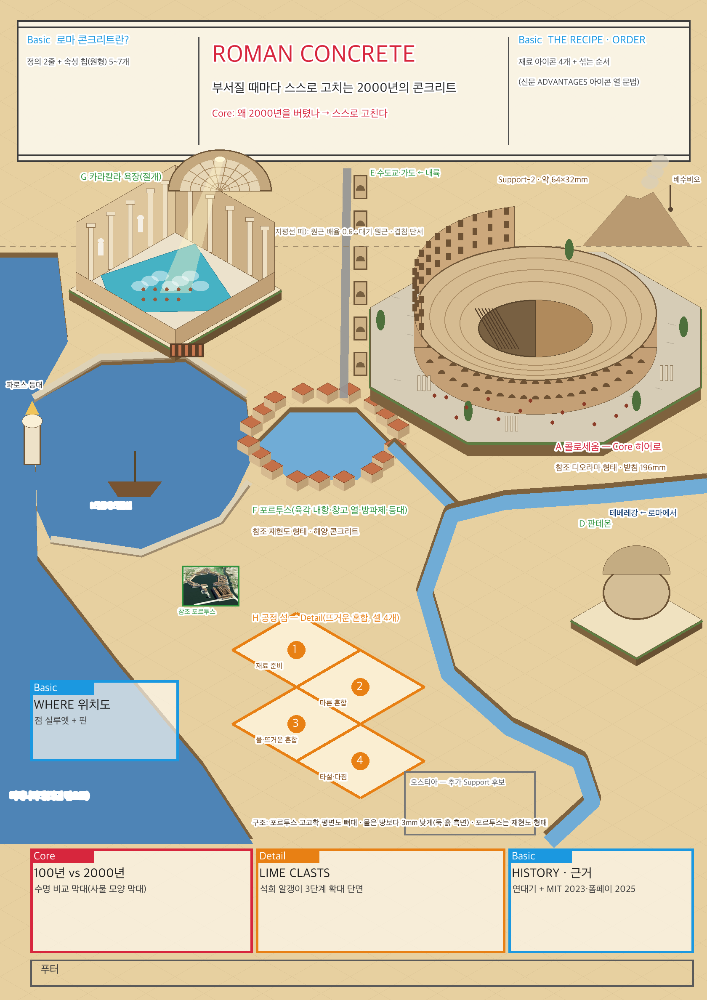

- **사용자 지정**
  - 전체 중앙 지도 구조는 포르투스 고고학 평면도처럼 잡되 입체감은 보이게 한다.
    - 참조: `docs/references/assets/지도구조-참조-포르투스평면도.png`, 원 URL https://archaeology.org/wp-content/uploads/2024/06/image-47.gif
  - 포르투스 항은 재현도처럼 만든다.
    - 참조: `docs/references/assets/포르투스-참조.jpg`
- **평면도에서 가져온 뼈대**
  - 왼쪽 바다
  - 곡선 방파제 두 팔로 감싼 클라우디우스 내항과 입구의 파로스 등대
  - 가운데 왼쪽의 트라야누스 육각 내항과 다르세나 연결 수로
  - 육각 내항에서 테베레강으로 가는 운하
  - 오른쪽에서 들어와 아래로 크게 굽이치는 테베레강
  - 운하·강·바다 사이의 섬(이솔라 사크라)
  - 맨 아래 강 하구의 오스티아
  - 내륙으로 이어지는 가도와 수도교
- **입체감**
  - 물면을 땅보다 약 3mm 낮게 그려 먼 쪽 둑에 흙 측면이 보이게 했다.
  - 오브젝트는 등각 디오라마로 땅 위에 올렸다.
- **구역 배정**

| 구역 | 놓은 것 | 근거 |
|---|---|---|
| 바다·내항 | F 포르투스: 육각 내항 + 붉은 기와 창고 열 + 곡선 방파제 + 등대(재현도 형태) | Support, 해양 콘크리트 |
| 섬 | H 공정 셀 4개 | Detail. 섬이 신문식 떠 있는 바닥 역할 |
| 오른쪽 위 내륙(로마 방향) | A 콜로세움 히어로 | 베수비오(Support-2)가 그 뒤 배경층에 가려진다 |
| 왼쪽 위 뒤쪽 | G 욕장 | |
| 테베레 동쪽 | D 판테온 | |
| 가운데 위 | E 수도교·가도 | 내륙에서 육각 내항으로 들어온다 |
| 맨 아래 | 오스티아 | 추가 Support 후보 자리 |
| 바다 위 | WHERE 위치도 | 바다가 고요한 영역 역할 |

### 6.0d 이전안 v7 (2026-10-18 16:00): 욕장은 뒤쪽으로, 아레나는 참조 디오라마 형태로

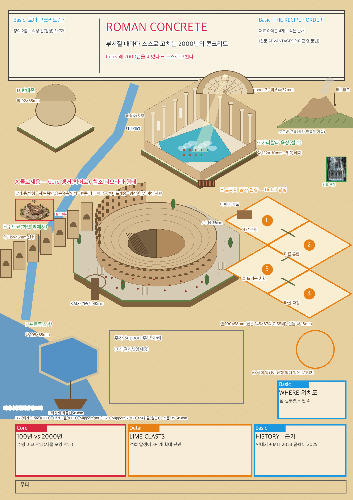

- **사용자 지정**
  - "뒷쪽으로 빼자"를 욕장을 지도 뒤쪽으로 옮기라는 뜻으로 해석했다.
  - 아레나(콜로세움)는 참조 이미지 형태로 만든다. 참조: `docs/references/assets/아레나-참조-localbanana.jpg`
- **욕장(v6)**
  - 위치: 앞쪽(아래 가운데)에서 뒤쪽(위 가운데, 타이틀 띠 바로 아래)으로 옮겼다.
  - 크기: Support라 배경층 축소는 하지 않는다. 약 132×110mm를 유지한다. 절개라서 뒤쪽에서도 실내가 보인다.
  - 앞쪽에 비워진 자리는 '추가 Support 후보 자리'로 표시했다. 조사 결과를 반영할 예정이다.
- **아레나(v7)**: 참조 디오라마에서 읽은 형태
  - 팔각형 흙 단면 받침(화면 폭 약 196mm)과 돌 포장 광장
  - 외벽은 뒤 왼쪽 조각만 4층 높이로 남고, 나머지 고리는 무너져 안쪽 아케이드와 관람석 층이 드러난다.
  - 아레나는 오른쪽 반만 나무 바닥으로 복원되고, 왼쪽 반은 하이포게움 미로가 노출된다.
  - 광장에는 사이프러스·올리브, 작은 기둥 폐허, 사람들을 둔다.
  - 와이어프레임은 형태 도식이다. 실제 모델은 참조 디오라마의 석재별 변화·GI·AO 수준으로 만든다.

### 6.0c 이전안 v5 (2026-10-18 15:55): 욕장은 하나, 참조 욕장처럼

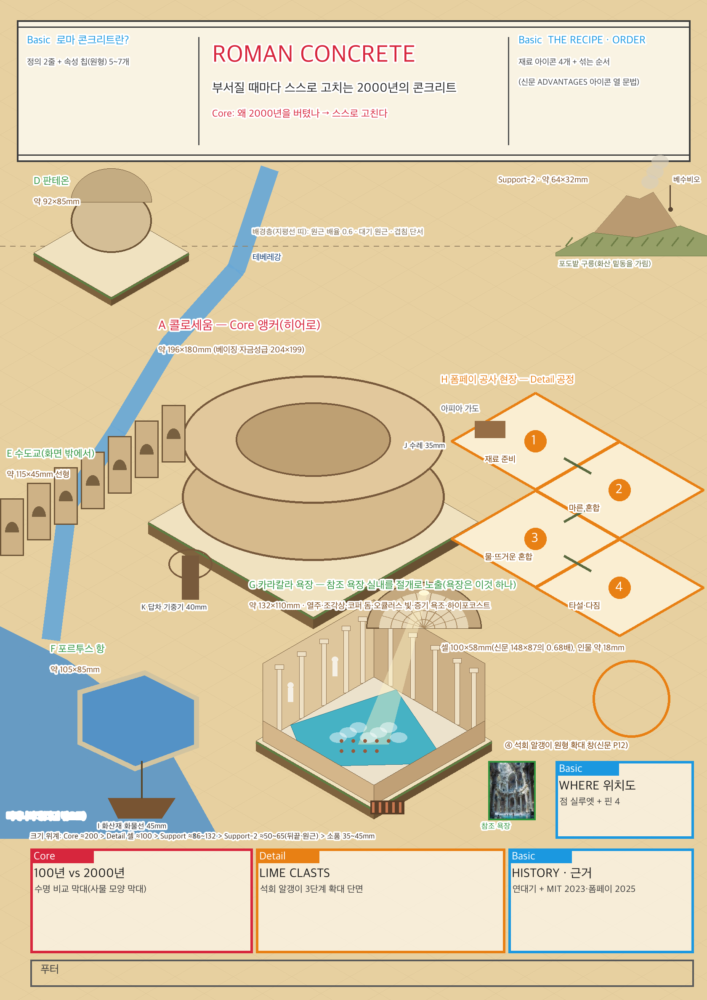

- **사용자 지정**
  - 욕장은 1개만 남긴다.
  - 그 욕장은 참조 이미지처럼 만들어야 한다. 참조: `docs/references/assets/욕장-참조.jpg`, 원 URL https://encrypted-tbn0.gstatic.com/images?q=tbn:ANd9GcQD5hIdAzMiZJYnKNnsB4rUCoLyXYc_fWD-quR34pHKMkljXvug4SBIqEg1&s=10
- **참조 이미지 판독**
  - 여러 층의 코린트식 열주와 벽감 조각상이 있다.
  - 격자 천장(코퍼)의 돔·반원 볼트가 있고, 오큘러스로 빛줄기가 내려온다.
  - 증기가 피어오르는 넓은 청록색 욕조에서 사람들이 목욕한다.
- **적용**
  - 헤르쿨라네움 교외 욕장은 뺀다.
  - 남은 욕장을 카라칼라 욕장으로 대응시키고, 위 요소를 모두 절개 단면 안에 넣는다.
    - 뒤 벽 열주
    - 벽감 조각상
    - 코퍼 반쪽 돔(단면에 콘크리트 두께)
    - 오큘러스 빛줄기
    - 증기 욕조
    - 목욕하는 인물
    - 하이포코스트 절개
  - 크기는 약 132×110mm다. 욕장이 하나로 줄어 실내를 읽을 수 있게 키웠다.
- **정확성 메모** [해석]
  - 참조는 AI 생성으로 보인다. 여러 층 발코니 같은 바로크풍 장식이 섞여 있다.
  - 분위기(규모·빛·증기·물·인물)는 따르고, 건축 요소(기둥 오더, 교차 볼트, 돔)는 실제 로마 황제 욕장 형식으로 맞춘다.
- **화산 밑동**: 헤르쿨라네움이 빠진 자리에 낮은 포도밭 구릉을 두어 겹침 원근을 유지한다. 79년 분화 전 베수비오 산비탈은 포도밭이었다(조사 결과로 확인 예정).

### 6.0b 이전안 v4 (2026-10-18 15:50): 욕장은 내부가 보이게 절개

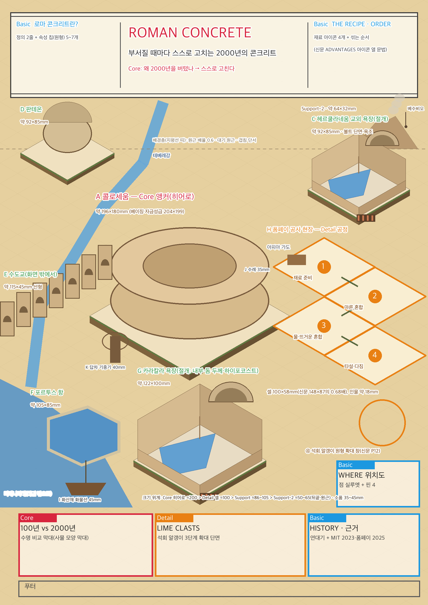

- **사용자 지정**: 욕장(목욕탕)은 내부 공간이 보여야 한다.
- **절개 규칙** [해석]
  - 벽: 관찰자 쪽 앞 벽 두 면(+X·+Y 면)은 높이의 약 30%로 낮게 자른다. 뒤 벽 두 면은 전체 높이로 남겨 공간을 둘러싼다.
  - 지붕: 걷어 낸다. 볼트·돔은 반쪽만 남겨 단면에 콘크리트 두께를 드러낸다. 로마 콘크리트 볼트를 보여 주는 장치다.
  - 내부: 냉탕(frigidarium)·온탕(tepidarium)·열탕(caldarium) 칸막이, 욕조, 목욕하는 인물
  - 하이포코스트(바닥 밑 난방): 앞 모서리 바닥을 잘라 벽돌 기둥(pilae)과 아궁이를 보인다.
- **선례**: 보존된 203X 비교 보드의 「서울 지하철」이 지상·대합실·승강장·열차를 입체 층으로 드러내는 절개 표현을 쓴다. 보드 설명 기준이며 실측하지는 않았다.
- **크기**
  - 카라칼라 욕장: 내부를 읽을 수 있도록 Support 표준보다 큰 약 122×100mm
  - 헤르쿨라네움 교외 욕장: 약 92×85mm. 같은 절개 문법을 쓴다.
- 나머지는 v3와 같다.

### 6.0a 이전안 v3 (2026-10-18 15:45): 화산을 Support-2로, 원근 규칙으로 축소

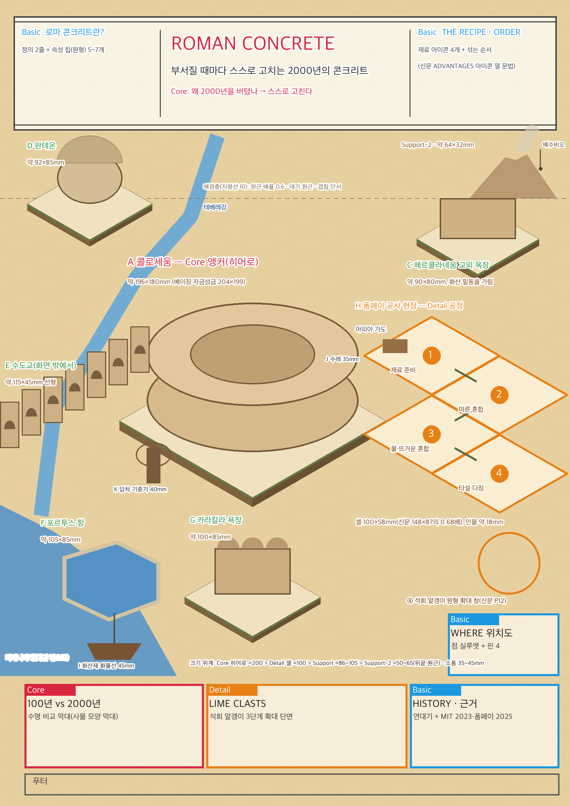

- **사용자 지정**: 화산은 'Support의 Support'(Support-2)다. 크기를 많이 줄이되, 무작정 줄이지 않고 원근을 고려해 뷰 윈도우에 어울리게 줄인다.
- **크기 위계** [해석]
  - Core 히어로 약 200mm
  - Detail 공정 셀 약 100mm
  - Support 랜드마크 86~105mm(베이징 표준 중앙값 86×80)
  - Support-2 50~65mm
  - 소품 35~45mm
- **원근 규칙(배경층)**
  - Support-2는 뷰 윈도우의 뒤끝, 즉 지도 위쪽 지평선 띠에만 둔다.
  - 등각은 직교 투영이라 원래 거리에 따른 축소가 없다. 그래서 배경층에만 '망원 원근'을 흉내 낸다.
  - 카메라 거리를 무대 깊이의 약 1.5배로 보면, 뒤끝 배율은 1.5/2.5 ≈ 0.6이다.
  - 표준 랜드마크 86mm × 0.6 ≈ 52mm다. 베수비오는 약 64×32mm로 정했다(산 실루엣이 옆으로 넓어서).
- **원근 단서 세 가지**
  1. 대기 원근: 바탕색과 50% 섞어 대비·채도를 낮춘다.
  2. 겹침: 앞쪽 헤르쿨라네움 교외 욕장이 화산 밑동을 가린다.
  3. 위치: 지평선 띠 위에 둔다.
- **라벨**: 설명 없는 깃대형 이름표다(베이징 R15, 작은 대상의 이름표 문법).
- **근거**: 베이징에서도 가장 먼 만리장성(실제 58.6km)이 지도 맨 위에 가장 작게(69.9×61.3mm) 놓였다.
- **그 밖의 변경**
  - 화산이 비운 오른쪽 위로 폼페이 공사 현장 셀 4개를 올렸다.
  - 그 아래에 석회 알갱이 원형 확대 창(신문 P12)을 추가했다.

### 6.0 이전안 v2 (2026-10-18 15:40, 사용자 피드백 반영)

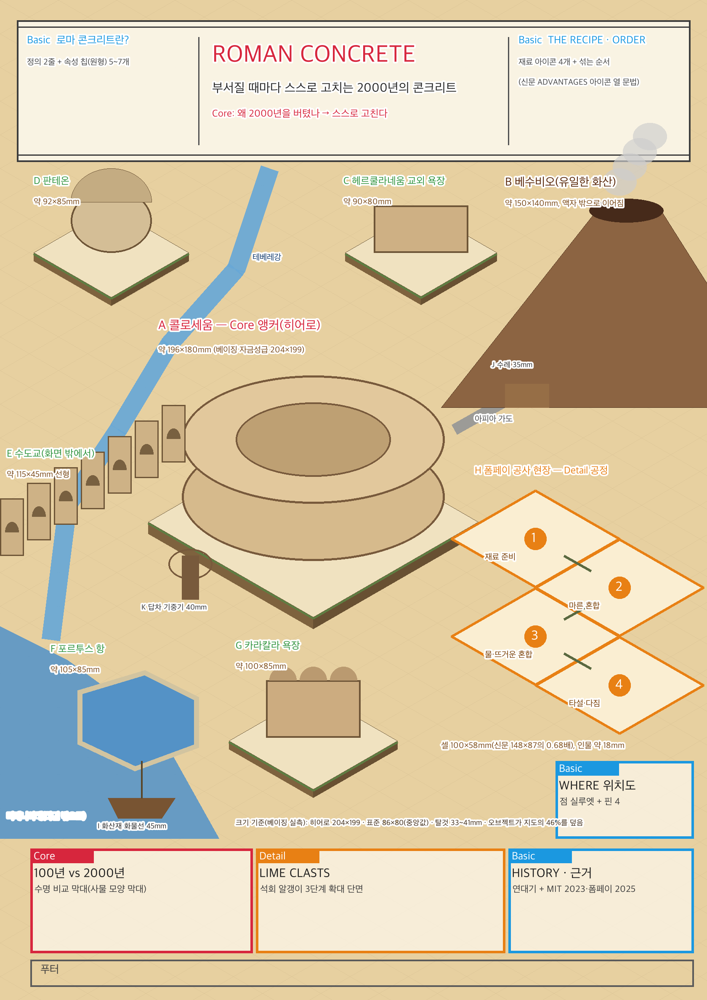

- **반영한 피드백**
  1. 로마 군집으로 묶지 않는다. 중앙 지도를 넓게 쓴다.
  2. 오브젝트를 더 크게 만든다. 크기는 베이징 실측 등급(3.5절)을 쓴다.
  3. 구획은 베이징과 다르게 짠다.
  4. 화산은 베수비오 하나만 둔다.
  5. 목욕탕과 화산 근처 건축물을 넣는다.
- **구획**(베이징과 다른 점)
  - 상단은 신문식 전폭 타이틀 띠 3분할이다: 왼쪽 Basic 로마 콘크리트란? | 가운데 Core 타이틀 | 오른쪽 Basic THE RECIPE·ORDER. 베이징식 모서리 패널을 쓰지 않는다.
  - 지도는 y 100~498mm 전폭이다. 오브젝트를 하나씩 따로 배치한다.
  - 하단 띠 3분할: Core 100년 vs 2000년 | Detail LIME CLASTS | Basic HISTORY·근거
- **지도 배치**

| 기호 | 오브젝트 | 위치 | 크기(목표) | 비고 |
|---|---|---|---|---|
| A | 콜로세움 | 중앙 | 약 196×180mm | Core 앵커, 히어로 |
| B | 베수비오 | 오른쪽 위 | 약 150×140mm | 유일한 화산, 액자 밖으로 이어짐 |
| C | 헤르쿨라네움 교외 욕장 | 위 가운데 | 약 90×80mm | 화산 옆 건축·목욕탕 |
| D | 판테온 | 왼쪽 위 | 약 92×85mm | |
| E | 수도교 | 왼쪽 가장자리에서 들어옴 | 약 115×45mm, 선형 | |
| F | 포르투스 항 | 왼쪽 아래, 바다 | 약 105×85mm | |
| G | 카라칼라 욕장 | 아래 가운데 | 약 100×85mm | |
| H | 폼페이 공사 현장 | 오른쪽 | 정사각 셀 4개(화면 100×58mm, 신문 셀의 0.68배), 인물 약 18mm | Detail 공정. 신문식 셀 체인·바닥 화살표 |
| I·J·K | 화산재 화물선, 수레, 답차 기중기 | 곳곳 | 35~45mm | 탈것·소품 등급 |

- **연결**: 테베레강은 위에서 왼쪽 아래 바다로 흐르는 세로 흐름이다. 아피아 가도는 콜로세움에서 베수비오로 간다. 위치도(Basic)는 오른쪽 아래 고요한 영역에 둔다.
- **아직 반영 전**: Support 추가 후보와 화산 표기 방식은 조사가 끝나면 갱신한다.
- 아래 6.1~6.4는 v1 기록이다.

### 6.1~6.4 이전안 v1 기록

- 와이어프레임: `figures/wireframe_v1.png` (1mm = 4px)

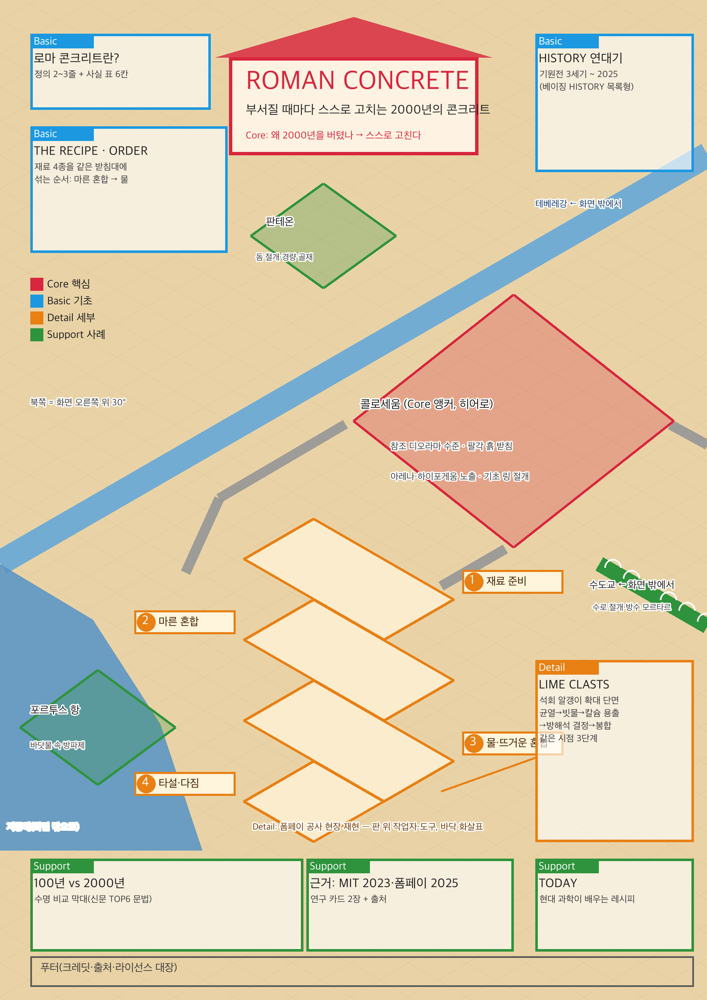

- 기준: 베이징의 공간 배치 위에 신문의 동선을 얹는다. 보존된 203X 비교 보드의 "현재 제작 기준"을 따른 것이다.
- 정보 위계는 사용자 지정 Core → Basic → Detail → Support를 따른다.

### 6.1 어디에 무엇을 두나

| 위계 | 위치 | 내용 | 근거 |
|---|---|---|---|
| Core | 상단 중앙 타이틀 록업(128~292 × 10~92mm), 로마 건축 액자(페디먼트·명문판) | "ROMAN CONCRETE / 부서질 때마다 스스로 고치는 2000년의 콘크리트", 핵심 질문과 답 | 베이징 T(건축 액자형 록업, 폭 40%) |
| Core 앵커 | 지도 중앙~오른쪽(205~400 × 175~325mm) | 콜로세움 히어로 | 베이징 중심 블록(폭 약 45%, 중앙~오른쪽) |
| Basic | 좌상 2단(18~125 × 20~65, 18~135 × 75~150mm) | ① 로마 콘크리트란?(정의+사실 표) ② THE RECIPE·ORDER(재료 4종 받침대 + 섞는 순서) | 베이징 L1·L2, 신문 T의 정의 박스, 릴스의 THE RECIPE 받침대 장치 |
| Basic | 우상 1단(318~412 × 20~102mm) | HISTORY 연대기(기원전 3세기 ~ 2025) | 베이징 R1 목록형 타임라인 |
| Detail | 지도 중앙 아래(약 150~330 × 330~505mm) | 폼페이 공사 현장 재현. 공정 ①재료 준비 ②마른 혼합 ③물·뜨거운 혼합 ④타설·다짐 | 신문 M(2:1 판 지그재그, 번호 간판 좌우 교대, 바닥 화살표, 작업자) |
| Detail | 우하 패널(318~412 × 392~500mm) + 확대선 | LIME CLASTS: 석회 알갱이 확대 단면, 같은 시점 3단계(균열 → 빗물·칼슘 용출 → 방해석 결정·봉합) | 신문 R3(주석 지면 = 실물 확대 도해), 무대 끝에서 칼럼이 파고드는 맞물림 |
| Support | 지도 위 랜드마크 + 라벨 카드 | 판테온(북서), 수도교(동쪽 가장자리에서 들어옴), 포르투스 항(서쪽 바다), 폼페이(남쪽, 공정 현장) | 베이징 랜드마크 라벨 문법, 거리 압축·방위 규칙 |
| Support | 하단 3분할 띠(y 510~565mm) | 100년 vs 2000년 막대 / 근거: MIT 2023·폼페이 2025 / TODAY 현대 과학이 배우는 레시피 | 베이징 B1~B3, 신문 R5 막대 문법 |
| Basic | 좌측 중간 고요한 영역(약 18~135 × 160~240mm) | WHERE 위치도: 이탈리아 중부 점 실루엣 + 핀 4개(로마·포르투스·포추올리 화산재 산지·폼페이) | 베이징 위치도(R23·R24). 지도가 지리를 압축하므로 실제 위치로 보완 |

**적용할 도식 문법(5.6절 기준)**
- **지도 위 라벨**
  - 랜드마크 옆 벽면(−30° 기본)에 세운다.
  - 스택: 영문 압축 볼드 → 국문 볼드 + 라틴어 원명 위첨자(한자 위첨자 자리) → 규선 → 본문
  - 예: Pantheon / 판테온 ᴾᴬᴺᵀᴴᴱᴼᴺ, Amphitheatrum Flavium
- **지형명**: 테베레강, 아피아 가도, 지중해는 바닥에 눕힌 톤온톤 글자로 쓴다.
- **패널**: 박스 없이 여백으로 구획하고, 영문 초압축 대제목 + 국문 소제목을 쓴다.
- **타이틀**: 로마 건축(개선문 또는 신전 페디먼트·명문판)의 정면 입면 프레임이다.
- **색**: 2색 체계(바탕 + 정보 잉크 한 색)다. 초안은 참조 디오라마의 모래색 바탕 + 진한 폼페이 레드 정보 잉크다(결정 필요).

### 6.2 어디에 어떤 3D·2.5D 모델을 두나

**수준 기준(사용자 지정, 2026-10-18)**
- 배치되는 2.5D·3D 모델은 **모두** 참조 이미지(LocalBanana 미니어처 콜로세움 디오라마)와 같은 수준으로 만든다. 콜로세움만이 아니다.
  - 참조 이미지: https://images.localbanana.io/uploads/1770698984162-6uksbq-full.jpg
- 기준 요소
  - 실제 기하로 된 깊은 개구부(아치 안쪽 면, 깊이 층 2개 이상)
  - 블록마다 다른 석재·벽돌 코어 노출·지면 쪽 풍화·틈새 식생
  - 따뜻한 GI·AO와 왼쪽 위 부드러운 키 라이트 하나
  - 작은 인물·노점·암포라·사이프러스·올리브 같은 세트 드레싱
  - 흙 단면이 보이는 받침
- 화면 평행의 정보 도식(차트·타임라인·아이콘·표)은 모델이 아니다. 203X식 평면 벡터로 둔다.
- 받침 [해석]: 랜드마크마다 참조처럼 흙 단면 받침(디오라마 타일)에 올려 지도 바탕 위에 놓는다. 두 벤치마크에 이미 같은 문법이 있다.
  - 베이징: 랜드마크를 두께가 보이는 녹지·연못 판에 올렸다.
  - 신문: 공정 판의 흙·잔디 측면
- 인쇄 해상도(합격 기준 1): 히어로는 받침을 뺀 폭 1736~2232px 이상, 주변 랜드마크는 744~1240px 이상을 고유 해상도로 만든다(300ppi).

| 모델 | 위치 | 수준 | 근거 |
|---|---|---|---|
| 콜로세움 | 중심 앵커 | 참조 디오라마 수준. 팔각 흙 받침, 아레나·하이포게움 노출, 콘크리트 기초 링 절개 | 중심 블록 = 가장 크다(폭 약 45%) |
| 판테온 | 북서(콜로세움 위 왼쪽) | 참조 디오라마 수준. 흙 받침, 돔 절개(코퍼·오큘러스·위로 갈수록 가벼워지는 골재), 광장 인물·노점 | 주변 랜드마크(크기 평준화 2~4배) |
| 수도교 | 동쪽, 오른쪽 가장자리에서 들어오는 아케이드 | 참조 디오라마 수준. 석재별 변화가 있는 반복 아치, 수로 절개, 틈새 식생, 들판 인물 | 베이징 고속철처럼 액자 밖에서 들어오는 연결선 |
| 포르투스 항 | 서쪽, 왼쪽 가장자리 바다 | 참조 디오라마 수준. 육각 내항·방파제·창고·배·하역 인물 | 강 → 바다 지리, 액자 밖으로 이어지는 바다 |
| 폼페이 공정 판 4장 | 지도 중앙 아래 | 참조 디오라마 수준의 미니어처 공사 현장. 흙·잔디 측면 판 위에 작업자·석회 더미·혼합 구덩이·비계·거푸집·암포라 | 신문 계단형 바닥 |
| 석회 알갱이 단면 | 우하 패널 | 같은 조명·재질 문법의 확대 '단면 블록'(콘크리트 덩어리 속 석회 알갱이·균열·방해석 결정). 화면 평행 패널 안에 놓는다 | 신문 R3 확대 도해 |
| 테베레강·로마 가도 | 지면 연결선 | 지면 요소(받침 사이를 잇는 평면) | 베이징 강·도로 |

### 6.3 작업 흐름과 서사 흐름

1. **서사 흐름(위 → 아래)**
   - Core(타이틀: 왜 2000년?) → Basic(좌상 재료·순서, 우상 역사) → Core 앵커(콜로세움: 2000년째 서 있다)
   - → Detail(공정 ①→④가 지그재그로 내려온다) → Detail(석회 알갱이 확대: 스스로 고치는 원리)
   - → Support(지도 위 사례 랜드마크, 하단 띠의 수명 비교·근거·현재)
   - 릴스의 흐름(질문 → 레시피 → 순서 → 뜨거운 혼합 → 석회 알갱이 → 균열 치유 → 근거 → 100 vs 2000)과 같은 순서다.
2. **작업 흐름**
   - 신문 방식 그대로 판 위에서 번호 간판(좌우 교대) → 작업자·도구 → 바닥 화살표 순서로 읽힌다.
   - 마지막 판에서 확대선이 석회 알갱이 패널로 이어진다. 부분과 전체의 관계다.
3. **방위**: 베이징과 같은 규칙으로, 북쪽을 화면 오른쪽 위 30°에 둔다. 그러면 지리가 저절로 맞는다.
   - 판테온 = 위(북서)
   - 포르투스 = 왼쪽(서)
   - 수도교 = 오른쪽(동)
   - 폼페이 = 아래(남동)

### 6.4 열려 있는 결정

- 타이틀 형식: 베이징식 건축 액자 록업 vs 신문식 전폭 띠. 초안은 베이징식이다.
- 좌측 타임라인: 신문식 세로 리본을 쓸지, 베이징식 우상 목록으로 줄일지. 초안은 베이징식이다.
- 지도 바탕색(신문 카키·베이징 빨강에 대응하는 색): 초안은 참조 디오라마의 모래색 계열이다.

---

## 7. 근거 구분

- **[실측]** 투영 각도, 영역 좌표·비율, 판 치수·피치·측면 두께, 지리 적합 오차와 거리 지수, 팔레트
- **[추정]** 흐린 영역의 위치, 랜드마크 높이(±10%), 화면 밖 연장
- **[해석]** 동선, 효과, 규칙화, 적용안
- 원자료와 스크립트: `.work/out/`, `.work/scripts/`
