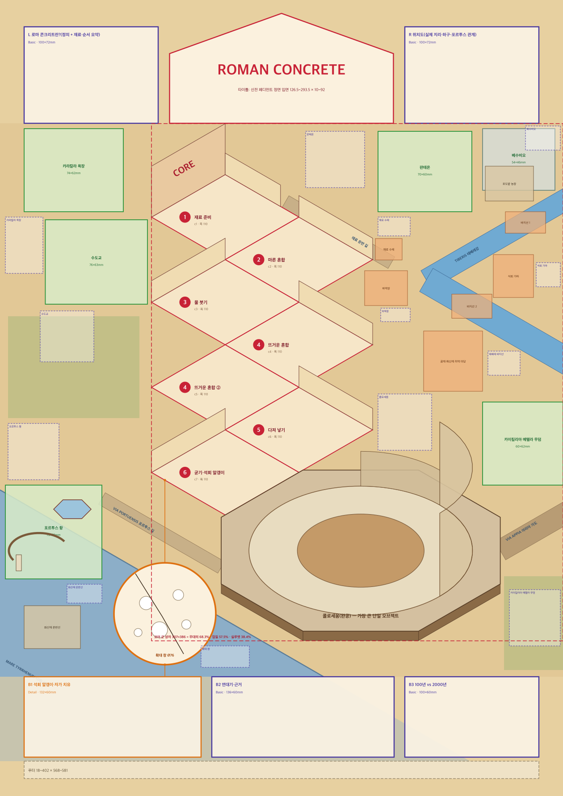

# 도시 인포그래픽 종합 분석: 203X 도시편 → 로마 편 최종 배치 사양

- 작성일: 2026-10-18
- 대상: 203X(Infographics Lab 203) 도시·지역·단지·유적편 14점, 기존 벤치마크 2점(베이징·신문 제작 과정), 로마 보조 자료 3점(Gus Morais, Trabacchi 1960, Gismondi 모형)
- 목적: 로마 콘크리트 A2 세로 포스터를 203X 도시 인포그래픽 시리즈의 '로마 편'으로 짓기 위한 최종 배치 사양을 정한다.
- 산출물
  - 최종 배치 사양 JSON: `/Users/um-yunsang/roman-concrete-private-refs/.work/out/refs-analysis/final_layout_spec.json`
  - 배치 골격 미리보기: `/Users/um-yunsang/roman-concrete-private-refs/.work/out/refs-analysis/final_layout_spec_preview.png` (SVG 원본 같은 폴더)
  - 기하 정의·검사 스크립트: `.work/out/refs-analysis/_work/final_spec_data.py`, `final_spec_check.py`, `final_spec_build.py`, `final_spec_svg.py`, 검사 결과 `final_spec_check.json`
- 근거 표시: **[실측]** 픽셀·선분으로 잰 값, **[관찰]** 이미지를 보고 확인한 사실, **[해석]** 측정에서 끌어낸 판단, **[계산]** 이 사양의 기하 모델로 계산한 값

---

## 0. 핵심 결론 7가지

1. **코어 군은 '세로 획 + 넓은 밑' 꼴로 짓는다.** [해석]
   - 세로 획은 타이틀 아래에서 곧게 내려오는 신문식 지그재그 셀 기둥(셀 7개, 폭 110mm)이다. 밑은 무대 아래쪽에 앉은 아레나(208×163mm)다.
   - 마지막 셀이 ↘ 한 걸음으로 아레나 받침에 0mm로 이어진다. 파리·베를린·타이베이의 'ㅗ/⊥' 꼴에 지도교수의 'L'(공정이 콜로세움으로 흘러듦)을 얹은 형태다.
2. **코어 군 크기는 세 값으로 잰다.** [계산]
   - 실루엣 38.4%(66,400mm²), 볼록 껍질 57.5%(99,700mm²), 상자 68.3%(118,500mm²). 지도 무대(420×413mm) 대비 값이다.
   - 레퍼런스 절대 면적 범위(실루엣 47,900~73,700, 껍질 70,700~99,400, 상자 98,200~122,000mm²) 안의 위쪽 끝이다. 지도교수 E의 45~60%는 껍질 기준으로 맞춘다.
3. **강은 오른쪽 위의 '<' 굽이 하나다.** [해석] 타이베이·상하이처럼 두 끝을 모두 오른쪽 변 밖으로 블리드한다. 굽이 바깥 둑의 하역장에서 재료 운반 길이 1단계 셀로 들어간다. 코어 체인과 아레나가 맞닿는 왼쪽 위에서는 떨어져 있다.
4. **바다는 왼쪽 아래 모서리 전부다.** 해안선은 ±30° 직선 하나이고, 바다는 왼쪽 변·지도 아래 변 밖으로 블리드해 하단 띠 밑으로 흐리게 이어진다(홍콩·청와대 선례).
5. **Support 5개 + 베수비오는 받침 없이 한 장의 지도에 묻는다.** 모두 길·강·해안·코어에 닿는다(도쿄 19/23). 아레나 바닥점에서 134~339mm에 좌 3·우 3으로 흩는다.
6. **크기 위계는 숫자로 통과한다.** [계산]
   - 아레나 34,069mm²가 최대 단일 오브젝트이고, 최대 셀(11,218)의 3.0배다.
   - 단계 상자는 8,783~11,218mm²로, Basic·Detail 최대(8,160)보다 크다.
   - Support 최대는 포르투스 5,040mm²로, 상한(확대 창 5,776 ÷ 1.1 = 5,251)보다 작다. 베수비오는 2,484mm²다.
7. **사용자 결정과 레퍼런스가 부딪친 곳은 13곳이다.** 사용자 결정을 따르고 7장에 근거를 적었다. 가장 큰 변경은 두 가지다.
   - 스케치의 콤마형(왼쪽으로 불룩한 '<')을 세로 지그재그 기둥으로 바꿨다.
   - 강을 '콜로세움 오른쪽을 따라 위→아래'에서 '코어 군 오른쪽 위 굽이'로 바꿨다.

---

## 1. 자료와 가중치

### 1.1 가중치(사용자 지시 19:48 "스케치의 가중치는 일단 최소화해, 도시인포그래픽들의 가중치가 우선적이야")

| 순위 | 근거 | 이 사양에서 쓰는 방식 |
|---|---|---|
| 1 | 도시 인포그래픽 레퍼런스 정밀분석(17점) | 코어 군의 형태·자리·크기, Support 지도 배치, 패널·타이틀·라벨·밀도의 1차 근거 |
| 2 | 203X 베이징·신문 정밀분석 | 틀 좌표(타이틀·패널·무대), 라벨 스택, 공정 셀 문법 |
| 3 | 사용자 확정 결정 | 바꾸지 않는다. 1과 부딪치면 3을 따르고 충돌 표(7장)에 적는다 |
| 4 | 지도교수 비평의 원칙 | 원칙만 지킨다. 구체 모양(L자·강 오른쪽)은 1·2로 정한다 |
| 5 | 손 스케치·구상도 v3 | 참고만 한다 |

### 1.2 측정 방법 요약 [실측]
- 레퍼런스: 정규 1000×1400 좌표, A2 환산 x 0.42mm/px, y 0.4243mm/px. 고해상 타일 3장(원본 2000×2800의 좌상·중우·좌하)을 템플릿 정합(일치도 0.94~0.99)으로 붙였다.
- 투영: OpenCV LSD 길이 가중 방향 히스토그램
- 코어 군: GrabCut 마스크 + 라벨 상자 + 물길을 13mm 닫힘으로 묶고 구멍을 메운 실루엣, 볼록 껍질, 무대로 자른 바깥 상자
- 이 사양의 값: 같은 방법을 사양 다각형(셀·간판·팔각 받침·벽·강 띠·디테일 상자)에 적용했다. 4px/mm 래스터이고, 스크립트는 `final_spec_check.py`다.

---

## 2. 레퍼런스별 핵심 실측표

### 2.1 틀·코어 군 [실측]

코어 군 %는 지도 무대 대비 값이다. 순서는 상자 / 껍질 / 실루엣(또는 덩어리)이고, '세/가'는 상자의 세로÷가로다.

| 레퍼런스 | 호 | 투영 | 지도 무대 세로 | 패널 수·면적 | 타이틀 폭 | 코어 군 상자/껍질/실루엣 | 코어 상자 mm(세/가) | 무게중심(x,y) | 히어로 |
|---|---|---|---|---|---|---|---|---|---|
| 파리 | 2021.04 | 30.0° | 74.8% | 6 · 12.4% | 46.2% | 60.1 / 38.5 / 25.6 | 254×460(1.81) | 0.52, 0.71 | 에펠탑 높이 69.3%, 록업 18.2mm 침범 |
| 상하이 | 2020.12 | 30.2° | 68.7% | 7 · 15.8% | 49.6% | 57.3 / 45.3 / 32.5 | 282×410(1.46) | 0.70, 0.43 | 동방명주 46.1%, 61.9mm 침범 |
| 홍콩 | 2022.04 | 30.0° | 71.4% | 6 · 13.1% | 46.0% | 62.3 / 48.7 / 37.5 | 300×381(1.27) | 0.535, 0.42 | 좌우 기둥 ICC 50.2%·2IFC 44.2%, 30.5mm 침범 |
| 도쿄 | 2021.05 | 30.0° | 80.3% | 6 · 12.6% | 49.7% | 47.2 / 35.3 / 27.6 (확장 60.5 / 49.6 / 36.8) | 258×367(1.43) | 0.564, 0.465 | 스카이트리 59.5%(오른쪽 기둥), 도청 0.8mm 접촉 |
| 뉴욕2 | 2022.09 | 30.1° | 95.9% | 5 · 10.9% | 37.3% | 29.5 / 22.1 / 16.0 | 390×181(가로) | 0.449, 0.344 | 세로 히어로 없음(메트 높이 15.6%) |
| 뉴욕1 | 2018.03 | 26.0° | 82.0% | 6 · 15.7% | 62.2% | 31.9 / 26.6 / 19.7 | 219×302(1.38) | 0.593, 0.403 | 엠파이어 47.3% |
| 서울 | 2018.09 | 26.0° | 66.1% | 6 · 15.7% | 31.9% | 32.1 / – / 25.3 | 160×330(2.06) | 0.682, 0.481 | 롯데월드타워 38% |
| 런던 | 2017.12 | 26.0° | 72.1% | 7 · 16.5% | 63.5% | 105 / – / 46.2 | 389×487 | 0.467, 0.514 | 빅벤 73.4%, 66mm 관통 |
| 베를린 | 2022.05 | 30° | 80.4% | 5 · 8.8% | 43.9% | 60.9 / – / 21.5 | 233×525(2.25) | 0.586, 0.655 | TV탑 75.6%, 44mm 관통, '⊥' |
| 타이베이 | 2023.12 | 30.0° | 73.5% | 7 · 11.0% | 41.7% | 20.5 / – / 10.8 | 147×350(2.38) | 0.34, 0.61 | 101 51.6%, 'ㅗ' |
| 자금성(단지) | 2020.10 | 30.1° | 64.3% | 6상자 · 27.4% | 52.5% | 55.5 / – / 58.9(궁역 실면적) | 363×382(1.05) | 0.68, 0.65 | 끌어낸 모형 1.9~2.1배 |
| 청와대(단지) | 2022.07 | 30.1° | 70.7% | 5 · 18.1% | 54.6% | 34.6 / 21.7 / 16.0 | 297×206(0.69) | 0.67, 0.41 | 본관 202×146mm |
| 피라미드(유적) | 2024.04 | 30.0° | 46.4%(장면) | 13 · 39.4% | 57.7% | 85.4 / 66.6 / 46.1(장면 대비) | 367×270(0.74) | 0.49, 0.61 | 높이 1.22배 과장 |
| 제주(지역) | 2018.08 | 26° | 지도 2장 | 글 6 · 12.5% | 51.9% | 코어 군 없음 | – | – | 한라산 끌어낸 모형 143×88mm |
| 베이징(벤치마크) | 2024.03 | 30.0° | 69.5% | 6 · 16.1% | 40% | 자금성 블록 실면적 16.7% | 204×199 | – | CCTV 탑 약 277mm 척추 |
| 신문(벤치마크) | 2025.04 | 30.0° | 무대 42% | 칼럼형 | 전폭 띠 | 공정 바닥 227×462mm | – | – | 셀 9개(148×87mm), 1·1·3·2·1·1 |

### 2.2 강·지면·라벨·밀도 [실측]

| 레퍼런스 | 강·물 | 지면 방식 | 라벨 수·방향 | 지시선 | 오브젝트 밀도(무대 대비) |
|---|---|---|---|---|---|
| 파리 | 센강 세로 두께 18~22mm. 오른쪽 변에서 들어와 앞-왼쪽 모서리 폭포로 나감, 통로 5.8% | 떠 있는 녹색 판 9개 + 남색 도로 | 15(+30° 13, −30° 2) | 브래킷 8·규선 연장 6 | 56.4%(상한) |
| 상하이 | 황푸강 '<': 윗팔 19.5·앞팔 30.8mm, 두 끝 오른쪽 블리드, 코어가 굽이 안쪽, 통로 9.3% | 연속 지면, 받침 3개뿐 | 21(+30° 12, −30° 9) | 없음(바로 옆에 붙임) | 49.1% |
| 홍콩 | 빅토리아 항 수로 28.9mm(−30°), 앞바다 = 하단 패널 받침 | 땅판 2장, 앞 모서리 30° | 16(+30° 11, −30° 5) | 브래킷 약 10·규선 약 5 | 48.3% |
| 도쿄 | 스미다강 수직 폭 14.2~17.5mm, 코어 오른쪽 아래 가장자리, 2.8% | 떠 있는 판 + ±30° 도로(주 18mm·보조 9~14mm, 흰 중앙선 1.6mm) | 21(벽면 12/12 −30°) | 세로 깃대 24~47mm·규선 연장 | 40.5% |
| 뉴욕2 | 이스트강 76~94mm, 코어와 패널 땅을 가름 | 연속 지면(땅 41.7%·물 17.3%) | 20(+30° 6·−30° 2·바닥 글) | 수직 + 끝점 | 26.3% |
| 서울 | 청계천 7~13mm(다리로 이음), 한강은 판 아래 물 바닥(무대의 9.0%) | 좌우 블리드 띠 판, 앞 변 단면 17~19mm | 16(+26°) | 브래킷·규선 연장, 라벨 기둥 | 48.1% |
| 베를린 | 슈프레강 13~20mm, 아래로 흐려지며 블리드 | 회청 바탕 + 얇은 판 + 주축 길 17mm | 15(+30° 7, −30° 8) | 브래킷·규선 연장 | 39.4% |
| 타이베이 | 단수이강 '<' 14~17mm, 오른쪽 변에서 두 번 블리드, 코어와 120mm 떨어짐, 1.7% | 떠 있는 판 + 길 14.7mm | 18(−30° 11/15) | 왼쪽 세로 브래킷 약 25mm | 42.1% |
| 자금성 | 해자 5.7mm(실제 폭의 1/3) | 단지 평면 그대로 | 깃발 약 38 | 깃발 아래 짧은 사선 | 궁역 안 73.2% 채움 |
| 청와대 | 강 없음(북악산 배경 띠, 무대의 26.5%) | 연속 단지 지도, 2색 관람 경로선 | 스택 9(위 +30°·아래 −30°) + 태그 4 | 수직 깃대·규선 연장 | 건물 16.4%, 건물+나무 30.7% |
| 베이징 | 대각 강 띠 + 자금성 해자, 오른쪽 위 블리드 | 빨간 연속 지면, 직교 격자 | 22(−30° 14, +30° 3, 지형명 5) | 수직·±30°, 꺾임 ≤1, 끝점 0.9mm | 46.2% |

### 2.3 로마 보조 자료 [실측]

| 자료 | 투영·형식 | 로마 편에 쓰는 것 |
|---|---|---|
| Gus Morais(포로 로마노 숨은그림찾기) | 2:1 픽셀 등각 26.6°, 패널 0 | 폐허 소품 어휘(부러진 기둥·쓰러진 엔타블러처·벽돌 코어·틈새 식생), 작업 구역 군중 밀도(인물 간격 약 0.7키) |
| Trabacchi 1960(로마 조감 지도) | 원근 조감(±30° 선분 1.3%), 위가 남쪽 | 강 위상(테베레가 고대 코어를 가르지 않고 서쪽 바깥을 지남, 콜로세움 폭의 5.4배), 하구 옆 포르투스, 먼 곳을 위쪽 6~10.5% 띠에 모음, 지형명 바닥 글(T E V E R E) |
| Gismondi 모형(1:250 사진 3장) | 사진 원근(시선 고도 25.9~34.1°) | 콜로세움 이웃(클라우디우스 신전 정원·루두스 마그누스·네로 수도교), 강까지 콜로세움 폭의 5.3~5.7배, 건물 조직 73~87% |

---

## 3. 공통 문법(레퍼런스에서 반복해 나온 규칙)

### 3.1 틀
- 상단 가운데에 주제 건축의 정면 입면 타이틀이 온다. 폭은 36~50%이고, 좌우에 패널 열이 붙는다(좌 x 18~21mm에서 시작).
- 패널은 5~7개(중앙값 6), 면적 9.4~17.2%다. 상자·배경판 없이 바탕 위에 조판한다.
- 하단 띠는 9~12% 높이에 2~3개를 둔다. 하단 띠를 없애면 지도 무대가 80%까지 늘어난다(도쿄·베를린·파리).
- 지도 무대 세로는 상하 패널 띠가 있는 표준 틀에서 68.7~71.4%다.

### 3.2 코어 군
- 가장 큰 덩어리가 무대 가운데~오른쪽에 온다. 무게중심은 x 0.52~0.70, y 0.42~0.71이다.
- 세로 히어로가 있으면 상자가 세로형이다(세로/가로 1.27~1.81).
- 코어 위 끝이 타이틀 띠에 닿거나 침범한다(11점 중 5점 침범, 도쿄는 0.8mm 접촉). 아래 끝은 무대 바닥이나 하단 띠 직전까지 간다(파리·베를린).
- '세로 획 + 넓은 받침' 꼴이 반복된다: 파리 'ㅗ', 베를린 '⊥', 타이베이 'ㅗ'.
- 강은 코어의 가장자리를 두르거나 스친다. 코어 안을 가르지 않는다(상하이·도쿄·타이베이·베를린·서울).
- 공정의 끝이 완성품 바로 옆에 온다(피라미드: 형태 변화 띠의 끝 아이콘이 꼭짓점 왼쪽 위 15mm).

### 3.3 Support 지도
- 히어로 바닥점에서 127~340mm 고리에 흩는다(파리 127~263, 베이징 140~340). 히어로 앞(아래)은 비우거나 바다·패널에 맡긴다.
- 먼 곳은 가장자리·모서리·블리드로 보낸다(11점 중 8점).
- 지리는 구도를 우선한다(평균 오차 53~155mm, 거리 지수 0.09~0.60). 실제 지리는 위치도가 맡는다(베이징·타이베이·뉴욕2·청와대).
- 연결은 ±30° 도로·강·해안이 맡는다. 오브젝트 대부분이 길에 닿는다(도쿄 19/23이 2.5mm 안).

### 3.4 강·바다
- 강 띠는 수직 폭 14~20mm다. 길과 같은 급이다(도쿄·타이베이·베를린). 앞쪽 구간은 더 넓게 그린다(상하이 1.56배).
- 강 끝은 블리드하거나 흐린다(베를린).
- 큰 물은 경계나 패널 받침으로 돌린다(서울 한강 물 바닥, 홍콩 앞바다, 뉴욕 남색 바탕).

### 3.5 라벨
- 지도 위 글자는 모두 등각 평면에 놓는다. 이름은 벽면, 지형명은 바닥이다.
- 구역마다 한 방향을 쓰고, 그 구역의 선형 요소와 평행하게 한다.
- 스택은 영문 압축 볼드 → 국문 + 원어 위첨자 → 규선 → 본문 → 수치 줄이다.
- 지시선은 수직·±30°, 꺾임 ≤1, 끝점이다.
- 방위표·축척·범례는 지도에 두지 않는다.

### 3.6 밀도·색·투영
- 오브젝트는 지도 무대의 40~56%이고, 이웃 간격 중앙값은 0mm다.
- 바탕 한 색이 40~50%를 덮는다. 정보 잉크는 한 색, 강조색도 한 색이다.
- 2020년 이후작은 모두 진짜 등각 30°(±0.5°)다. 2017~18년작 4점과 Gus Morais는 26°라 각도 근거로 쓰지 않는다.

---

## 4. 로마 편 배치 원칙(근거·수치)

1. **P1 틀**
   - 상단 Basic 2개: L 로마 콘크리트란?(18~118×20~92), R 위치도(302~402×20~92)
   - 가운데 신전 페디먼트 타이틀: 126.5~293.5×10~92(폭 39.8%)
   - 하단 3분할: B1 18~150, B2 158~294, B3 302~402(모두 y 505~565). 푸터 18~402×568~581
   - 패널은 5개, 포스터의 14.6%다.
   - 근거: 도시편 패널 5~7개·면적 중앙값 13.2%, 베를린 최소안 5개, 중앙 타이틀 32~50%(베이징 40%), 머리글 영문 7.4~7.8mm + 국문 3.6~4.0mm·상자 없음
2. **P2 무대**: 지도 무대 y 92~505(413mm, 69.5%), 좌우 전폭이다. 근거: 표준 틀 68.7~71.4%
3. **P3 코어 군 크기** [계산]
   - 실루엣 38.4%, 껍질 57.5%, 상자 68.3%(307×386mm)다.
   - 레퍼런스 절대 면적 범위 안이다. 상자 %가 높은 것은 로마 무대(173,460mm²)가 레퍼런스(171,000~200,000mm²)보다 작고, 강이 오른쪽 변까지 이어지기 때문이다.
4. **P4 모양·자리**
   - 지그재그 셀 기둥(x 113~278) + 아레나(받침 앞 끝 y 478)의 'ㅗ'+L 발 꼴이다.
   - 세로/가로 1.26, 무게중심 (0.583, 0.507)
   - 근거: 세로/가로 1.27~1.81, 무게중심 범위, 파리·베를린·타이베이
5. **P5 타이틀 접촉**: CORE 입구 간판(38mm) 위 끝 y 92.25가 타이틀 아래 변에 닿는다. 근거: 5/11 침범, 도쿄 0.8mm 접촉. 페디먼트 글자를 지키려 접촉만 한다.
6. **P6 공정 → 완공**
   - c7의 +X 변이 팔각 받침 −X 변과 한 직선에서 0mm로 맞닿는다. c6 아래 꼭짓점이 받침 윗변 왼쪽 끝에 3mm로 닿는다.
   - 체인과 받침은 같은 높이의 단이다.
   - 근거: 피라미드, 신문 판 접촉 변, 지도교수 원칙
7. **P7 셀 문법**
   - 7셀(1·1·1·2·1·1), 화면 폭 110mm, 반 셀 55mm 엇갈림, 간판 16mm 좌우 교대
   - 바닥 화살표 7개가 x 195.5에 세로 한 줄로 선다.
   - 인물은 약 19mm, 셀당 2~3명이다.
   - 단계 상자는 Basic·Detail 최대의 1.08~1.37배다.
8. **P8 강**
   - 오른쪽 위 '<' 굽이다(타이베이·상하이). 윗팔 16mm·앞팔 20mm이고 두 끝 모두 오른쪽 블리드, 꺾임 1회다.
   - 강 통로는 무대의 2.4%다.
   - 굽이 바깥 하역장 → 재료 운반 길 → c1, 굽이 안 반도에 석회 가마를 둔다.
9. **P9 바다**
   - 해안선 y = tan30·x + 365.6((0,365.6)→(241.5,505))이고, 블리드하며 하단 띠 밑으로 흐리게 잇는다.
   - 바다는 무대의 9.8%다. 해안 단면은 10mm다.
10. **P10 Support 지도**
    - 받침 없이 묻고 길·강·해안·코어에 닿는다.
    - 아레나 바닥점에서 134~339mm(중앙값 271)이고, 좌 3·우 3이다.
    - 먼 곳은 모서리에 둔다.
11. **P11 Support 크기**
    - 상한 5,251mm²(= 확대 창 5,776 ÷ 1.1), 실제 3,720~5,040mm²다.
    - 베수비오 2,484mm²
    - 아레나÷Support 중앙값 7.4배(파리 7.9배)
12. **P12 길**
    - 아피아 가도는 16mm + 흰 중앙선이다. 아레나 오른쪽 문에서 ↗로 블리드하고, 메텔라가 길가에 선다.
    - 보조 길은 8~10mm다.
13. **P13 라벨**
    - 18개(벽면·깃대 13, 바닥 5)다.
    - 스택은 v16 표준(3.8/3.8+2.1/규선/3.0·4.15)이다.
    - 방향은 구역마다 하나다: 뒤쪽 줄·강 윗팔은 ↗, 나머지는 ↘. 방위표는 없다.
14. **P14 밀도**
    - 추정 51.2%다.
    - 코어 작업 구역은 붐비게, Support 구역은 성기게 둔다.
    - 빈 땅은 밭·포도밭·올리브 숲으로 채운다.
15. **P15 투영·색**
    - 등각 30°다.
    - 지도 라벨은 중립 잉크 한 색이다. 폼페이 레드는 타이틀·패널 제목·단계 번호·CORE 간판에만 쓴다.
16. **P16 확대 창**
    - Ø76, 중심 (123,458)에 두고 해안선에 걸친다.
    - c7 → 창 → B1을 꺾임 없는 수직선 두 개로 잇는다. 'A' 짝 표지를 단다.

> 원칙 전문(근거 수치 포함)은 사양 JSON의 `principles`에 같은 문장으로 들어 있다.

---

## 5. 최종 배치 사양 요약

### 5.1 틀(화면 평행)

| 요소 | x (mm) | y (mm) | 크기 | 비고 |
|---|---|---|---|---|
| 타이틀(신전 페디먼트 정면 입면) | 126.5~293.5 | 10~92 | 167×82 | 폭 39.8% |
| L 로마 콘크리트란?(Basic) | 18~118 | 20~92 | 100×72 | 정의 + 재료·순서 1~2줄, 상자 없음 |
| R 위치도(Basic) | 302~402 | 20~92 | 100×72 | 연한 판, 북쪽 위, 하구–포르투스·오스티아 관계 필수, 지도 범위 5구역 표시 |
| B1 석회 알갱이·자가 치유(Detail) | 18~150 | 505~565 | 132×60 | 바다 위 고요한 영역 |
| B2 연대기·근거(Basic) | 158~294 | 505~565 | 136×60 | |
| B3 100년 vs 2000년(Basic) | 302~402 | 505~565 | 100×60 | |
| 푸터 | 18~402 | 568~581 | 384×13 | |

### 5.2 코어 군

| 요소 | 자리 | 크기·형식 | 맞닿음 |
|---|---|---|---|
| c1 1단계 재료 준비 | 중심 (168.0, 162.0) | 마름모 110×63.5, CORE 입구 간판 38mm(뒤-왼쪽 변) + 1단계 간판(뒤-오른쪽 변 75%) | 간판 위 끝 y 92.25 = 타이틀 아래 변. 오른쪽 25%로 재료 운반 길이 들어온다 |
| c2 2단계 마른 혼합 | (223.0, 193.75) | 같음, 간판 뒤-오른쪽 | c1과 +X로 이어짐 |
| c3 3단계 물 붓기 | (168.0, 225.51) | 간판 뒤-왼쪽 | 왼쪽 꼭짓점 (113, 225.5)에 수도교 분배 탱크가 3mm로 닿는다 |
| c4·c5 4단계 뜨거운 혼합(2셀) | (223.0, 257.26)·(168.0, 289.02) | c4 간판 뒤-오른쪽 | 김(알파 40 이하), c5에 석회 알갱이가 섞인 반죽 |
| c6 5단계 다져 넣기 | (223.0, 320.77) | 간판 뒤-오른쪽 | 아래 꼭짓점이 받침 윗변 왼쪽 끝(226.0, 350.8)에 3mm |
| c7 6단계 굳기·석회 알갱이 | (168.0, 352.53) | 간판 뒤-왼쪽 | +X 변이 받침 −X 변과 0mm. 단면 블록에서 지시선 시작 |
| 아레나(콜로세움) | 중심 (269.11, 410.90), 팔각 R 92 | 상자 165.0~373.5 × 314.8~478.2(208.5×163.4, 34,069mm²) | 디오라마 좌우 반전: 4층 조각은 오른쪽 위, 왼쪽 위는 높이 12mm 이하 |
| 테베레강 윗팔 | (430,144.2)→(318,208.9) | 폭 16mm, ↙ | 오른쪽 변 블리드 |
| 테베레강 앞팔 | (318,208.9)→(430,273.6) | 폭 20mm, ↘ | 오른쪽 변 블리드 |
| 하역장 | 272~304 × 202~228 | 돌 부두·기중기·일꾼 | 굽이 바깥 둑 |
| 재료 운반 길 | (292,196)→(213,150.4) | 폭 10mm, ↖, 수레 1 | c1 뒤-오른쪽 변 입구 |
| 석회 가마 | 368~398 × 190~222 | | 굽이 안 반도 |
| 바지선 2척 | 377~407×158~174, 337~367×219.5~237.5 | 물 위 | |
| 골재·화산재 하역 마당 | 316~360 × 247~292 | 재료 더미 3·수레 1 | 앞팔 남쪽 둑 |

### 5.3 Support·Support-2·Detail

| 요소 | 상자(x0, y0, x1, y1) | 크기·면적 | 자리 논리 | 연결 |
|---|---|---|---|---|
| 카라칼라 욕장(절개) | 18, 96, 92, 158 | 74×62 · 4,588 | 뒤쪽(위) 왼쪽 | 욕장 앞길 → c1 |
| 판테온 | 282, 98, 352, 158 | 70×60 · 4,200 | 뒤쪽 시내, 강 윗팔 바깥 둑 | 재료 운반 길 북쪽 둑 |
| 수도교(아쿠아 클라우디아) | 33.8, 164, 110, 227 | 76×63 · 4,801 | 왼쪽 가운데, 3단계로 물을 댐 | 아치 열 바탕선 (33.8,180)→(110,224) |
| 카이킬리아 메텔라 무덤 | 360, 300, 420, 362 | 60×62 · 3,720 | 남동 교외(오른쪽) | 아피아 가도 북쪽 둑 |
| 포르투스 항 | 4, 362, 76, 432 | 72×70 · 5,040 | 서남서 해안(왼쪽 아래) | 육각 내항(54,380, 육지)·외항(28,410, 바다)·등대(14,424). 포르투스 길 출발 |
| 베수비오(Support-2) | 360, 96, 414, 142 | 54×46 · 2,484 | 가장 먼 곳(오른쪽 위 모서리) | 밑동을 포도밭 농장이 가린다 |
| 확대 창(Detail) | 중심 (123, 458) | Ø76 · 상자 5,776 | 해안선에 걸침 | c7 → 창 → B1 수직 지시선 |

### 5.4 길·바다·지형명

| 요소 | 좌표 | 형식 |
|---|---|---|
| 해안선 | (0, 365.6) → (241.45, 505) | ↘ 직선 하나, 단면 10mm(포르투스 부두 3mm) |
| 바다 | 해안선 아래 왼쪽 삼각형 + 하단 띠 밑 연장(y 568까지 흐림) | 무대의 9.8% |
| 아피아 가도 | (373.21, 410.9) → (430, 378.11) | 16mm + 흰 중앙선, ↗ 블리드 |
| 포르투스 길 | (76, 372) → (165, 423.38) | 10mm, ↘ |
| 욕장 앞길 | (92, 150) → (113, 162) | 8mm |
| 바닥 글 | TIBERIS 테베레강(윗팔 ↗) · MARE TYRRHENUM 티레니아해(바다 ↘) · VIA APPIA 아피아 가도(↗) · 재료 운반 길(↘) · VIA PORTUENSIS 포르투스 길(↘) | 자간 넓힌 대문자, 톤온톤 |

### 5.5 검사 결과 [계산]

| 항목 | 값 | 판정 |
|---|---|---|
| 코어 군 실루엣 / 껍질 / 상자 | 38.4% / 57.5% / 68.3% | 목표 30~40 / 45~60 / 55~70 안 |
| 코어 군 세로/가로, 무게중심 | 1.26, (0.583, 0.506) | 1.2 이상, 범위 안 |
| 아레나 ≥ 최대 셀 × 1.1 | 34,069 ≥ 12,340 | 통과 |
| 모든 단계 상자 ≥ Basic·Detail 최대 × 1.05 | 최소 8,783 ≥ 8,568 | 통과 |
| Support 최대 ≤ Basic·Detail 최소 ÷ 1.1 | 5,040 ≤ 5,251 | 통과 |
| Support 최소 ≥ Support-2 × 1.1 | 3,720 ≥ 2,732 | 통과 |
| 허용하지 않은 겹침 | 0건 | 통과 |
| 강 통로 / 바다 / 오브젝트 추정 | 2.4% / 9.8% / 51.2% | 레퍼런스 범위 안 |
| 라벨 | 18개 | 15~21 안 |

---

## 6. 레퍼런스 교훈 반영 대조

| 교훈(레퍼런스) | 반영 |
|---|---|
| 코어 크기를 세 지표로 잰다(파리·도쿄) | 검사표에 세 값과 목표 범위를 둔다 |
| 히어로 단일 상자 대신 코어 덩어리를 키운다(파리 7.9배) | 아레나 208×163(v16 184×166)으로 유지하고, 셀 폭을 80→110으로 키우고 강변 디테일을 붙였다 |
| 코어를 세로로, 무대 바닥까지(파리) | 셀 기둥은 y 92~384, 아레나 받침은 y 478 |
| 강이 코어를 감싸는 굽이(상하이·타이베이) | 오른쪽 위 '<' 굽이, 두 끝 오른쪽 블리드 |
| 강변 띠·굽이 안 디테일(상하이·타이베이) | 하역장·가마·하역 마당·바지선 |
| 받침 최소(상하이)·판 문법 금지(사용자 G) | 받침은 아레나 하나뿐 |
| 바다는 하단 패널 받침(홍콩·서울) | 바다를 하단 띠 밑으로 잇고 B1을 그 위에 얹는다 |
| 해안선 = 땅판 앞 모서리 30°(홍콩) | ↘ 직선 하나, 단면 10mm |
| 수로는 군과 군 사이에만(홍콩) | 강은 코어 체인–아레나 연결부 밖 |
| 탈것 32~46mm가 물과 땅을 잇는다(홍콩) | 운반선·바지선·수레 |
| 먼 곳은 모서리(도쿄·뉴욕) | 베수비오는 오른쪽 위, 포르투스는 왼쪽 아래 |
| 지도→패널 지시선(런던) | 확대 창 → B1 |
| 핵심 정보를 히어로에 붙인다(청와대) | 5·6단계 셀이 아레나 받침에 붙는다 |
| 공정 끝 = 완성품(피라미드) | c7 → 아레나 0mm |
| 끌어낸 확대 모형 짝(자금성) | 'A' 짝 표지 |
| 위치도가 지리를 맡는다(뉴욕2·청와대·타이베이) | R 위치도: 지도 범위 5구역, 하구–포르투스 관계 |
| 2017~18년작 26° 작품(뉴욕1·서울·런던·제주)과 Gus Morais는 각도 근거가 아니다 | 30° 유지 |

---

## 7. 충돌 처리(사용자 결정 우선)

| # | 충돌 | 처리 |
|---|---|---|
| C1 | Support 크기: 레퍼런스는 랜드마크 상자가 패널의 1.6~3.0배. 사용자 결정은 Support < Basic·Detail ÷ 1.1 | 사용자 결정. Support 60~76mm급, 밀도는 코어 군·밭·소품으로 채운다 |
| C2 | 받침 판: 파리·도쿄·베를린·타이베이는 떠 있는 판. 사용자 G는 섬 모음 금지 | 판을 옮기지 않는다. 받침은 아레나 하나, 셀은 같은 높이의 단 |
| C3 | 먼 랜드마크 크기: 뉴욕1 여신상은 포스터 높이 32%. 사용자 결정은 베수비오 = Support-2 | 모서리 자리만 따르고 54×46mm로 둔다 |
| C4 | 하단 띠: 도쿄·베를린·파리는 하단 띠를 없앤다. 사용자 틀은 하단 3분할 | 하단 띠 유지. 아레나를 y 478까지 내리고, 바다를 띠 밑으로 잇는다 |
| C5 | 강–바다–포르투스 위상: 트라바키는 하구 옆에 포르투스가 있어 F ①이 실제 위상. 사용자 결정은 바다 왼쪽 아래 + 강 오른쪽, 하구는 J | 강 두 끝을 오른쪽 블리드(F ②). R 위치도에 하구–포르투스·오스티아를 반드시 그린다 |
| C6 | 아피아 축: 트라바키는 콜로세움 → 아피아·메텔라 → 화산 구릉. 사용자 결정은 베수비오가 가장 먼 뒤쪽 | 아피아 가도를 ↗(베수비오 쪽)로 내고 메텔라를 길가에 둔다. 메텔라는 J의 오른쪽 아래에서 오른쪽 가운데로 옮겼다 |
| C7 | 패널 열 폭: 도쿄 81mm. 사용자 G는 L 폭 100mm | 사용자 폭 유지 |
| C8 | 지도교수 F의 L자·스케치 J의 콤마 vs 레퍼런스의 세로 코어 | 원칙은 지키고, 모양은 지그재그 기둥 + ↘ 발로 바꿨다. 6셀 '<'는 체인 폭 275mm이고, 아레나를 붙이면 받침이 x 470까지 나간다[계산] |
| C9 | 콜로세움 자리·강 경로(F·J) | 콜로세움을 (269, 411)로 내렸다(파리·베를린). 강은 아레나 오른쪽 47mm 틈에 넣으면 꺾임 6회 이상이라, 오른쪽 위 굽이로 바꿨다 |
| C10 | 수도교 자리: J 문구는 오른쪽 아래, 사용자 G는 3단계로 이어지는 자리 | 사용자 G. 왼쪽 가운데에서 c3로 물을 댄다 |
| C11 | 확대 창: J는 (70, 440) | (123, 458), Ø76. 포르투스에 왼쪽 변을 내주고, 지시선을 수직 하나로 |
| C12 | 코어 군 크기 기준: E 45~60% vs 레퍼런스 실루엣 25.6~37.5% | 껍질 기준으로 판정하고 세 값을 병기한다. 상자 절대 면적은 레퍼런스 범위 안 |
| C13 | 아레나 형태: LocalBanana 4층 조각이 뒤-왼쪽이라 셀 6·7을 가림 | 좌우 반전해 4층 조각을 오른쪽 위에 두고, 왼쪽 위는 12mm 이하 |

- 원문 문장은 사양 JSON의 `conflicts`에 있다.
- 그대로 지킨 사용자 결정
  - 상단 Basic 2개, 왼쪽 아래 모서리 바다
  - 포르투스 육각 내항은 육지, 외항·등대는 바다
  - Support는 한 장의 지도
  - 아레나가 최대 단일 오브젝트, Support < Basic·Detail, 베수비오 Support-2
  - 욕장 1(절개·뒤쪽), 화산 1, 모델 수준은 LocalBanana

---

## 8. 워커 전달 요약

| 패키지 | 받을 값 |
|---|---|
| core | `core_group.chain.cells`(중심·꼭짓점·간판·바닥 화살표·내용), CELL_W 110, 7셀. c1 오른쪽 25%는 길 입구 |
| arena | `core_group.arena`(중심·R 92·맞닿음 2개·형태 6항), 상자 208.5×163.4 ±5% |
| map | 강 `segments`, 해안선·바다(띠 밑 연장), 길 4개, 강변 디테일, 밭·포도밭, 바닥 글 5 |
| support_top | 욕장 S1, 판테온 S2, 베수비오 S6, 포도밭 농장 |
| support_bottom | 수도교 S3(c3 분배 탱크), 메텔라 S4(아피아 가도 길가), 포르투스 S5(앵커 3) |
| panels | 틀 좌표, 확대 창·지시선, R 위치도의 하구–포르투스 관계 |
| global | 검사표 맨 위에 코어 군 세 값과 판정. 단일 오브젝트 위계는 셀 단위(체인 전체는 하위 군) |

---

## 9. 확인용 구획 이미지

### 9.1 상위 5개(가중치 최우선)

### 9.2 나머지 203X

### 9.3 기존 벤치마크

### 9.4 로마 보조 자료

---

## 10. 한계

- **[계산]** 코어 군·밀도 값은 사양 다각형에서 계산한 것이다. 실제 렌더의 알파 실측과는 ±5%p 차이가 날 수 있다.
  - 강변 디테일은 상자로 넣었다. 실제 소품은 알파가 더 작다.
  - 그래서 v17 렌더 뒤 같은 방법(13mm 닫힘)으로 다시 잰다.
- 밀도 51.2%는 Support 상자 × 0.7, 소품 상자 × 0.6으로 어림한 값이다.
- 지리는 구도를 우선했다. 아레나 바닥점 기준 Support 거리는 134~339mm이고, 베이징 범위(140~340mm)의 위쪽에 가깝다.
- 레퍼런스 원본 최고 해상도는 지면의 약 50%만 덮는다. 저해상 구역의 작은 글자 수치(라벨 본문 크기 등)는 실측하지 못했다(각 레퍼런스 분석 참조).
